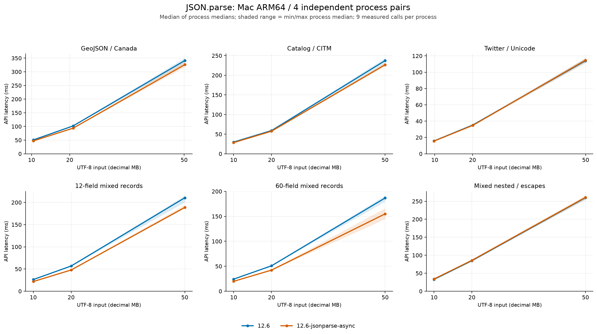
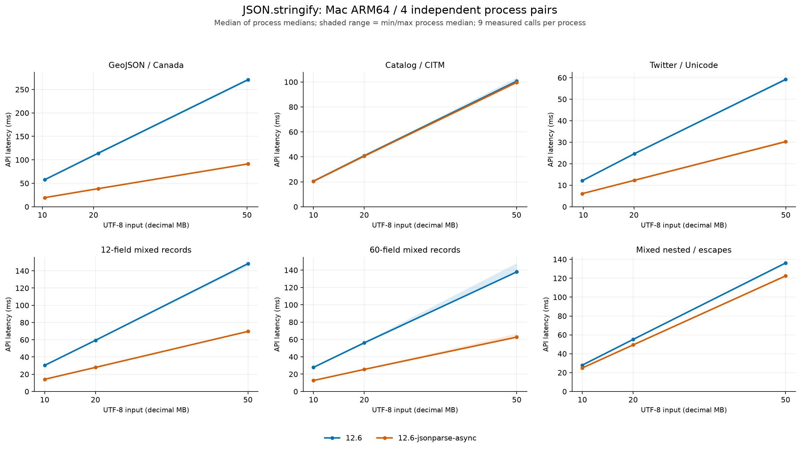

# 10/20/50 MB JSON：Mac ARM64 分支性能对比

日期：2026-10-26。受测优化版本为 `12.6-jsonparse-async` 的
`6f5f120c7388251eb9b90ddda1d575aa29cabfba`，基线为本地 `12.6` 的
`cd985f42b1e54328dfa52a01149d9350701df5b8`。两者的 V8 版本号均为 `12.6.228.49`。
同形对象直接构建与后台栈伪共享修复已在第一次本地提交 `6f5f120c7` 中提交，并快进
合并回 `12.6-jsonparse-async`。本报告与测试工具随后单独本地提交。

后续定位与修复见 [混合嵌套 JSON.parse 退化复测](json-mixed-parse-fix-mac-arm64.md)。
本报告保留首次对比的数据与负面结果；后续报告使用同一批 18 个文件重新冻结对照。

**本表是两个分支整体的比较。** 优化分支含此前的解析、序列化、数字转换和异步支持等
多轮改动，不能把全部差异归因于最后一次同形对象优化。测试没有更新或移动本地 `12.6` 分支。

## 汇总结果

下表对每个体积的六类输入等权计算加速比几何平均。加速比为基线耗时/优化版耗时；
耗时降低为 `1 - 优化版/基线`。负值表示变慢。完整逐场景数据及全部负面结果在后文。

| 目标体积 | JSON.parse 加速比 | parse 耗时降低 | JSON.stringify 加速比 | stringify 耗时降低 |
|---|---:|---:|---:|---:|
| 约 10 MB | 1.083× | 7.68% | 1.776× | 43.69% |
| 约 20 MB | 1.082× | 7.54% | 1.776× | 43.69% |
| 约 50 MB | 1.065× | 6.11% | 1.768× | 43.43% |

## 测试数据与网上来源

采用 [nativejson-benchmark](https://github.com/miloyip/nativejson-benchmark) 中常用的
`canada.json`、`citm_catalog.json`、`twitter.json`：分别提供数值密集的地理数据、
大量目录/映射对象，以及含 Unicode 的嵌套 API 响应。原始文件、README、许可证及 SHA-256
均保留，固定源提交为 `478d5727c2a4048e835a29c65adecc7d795360d5`。

公开种子先解析并紧凑化，再将完整子文档重复放入外层数组，按最接近目标体积的份数生成；
它们是明确标注的派生数据，不是原始小文件本身。原有类型与嵌套结构保留，解析过程仍需为
重复文档分别构造结果。生成记录的字段、ID 和部分字符串按序号变化。

额外生成的 12/60 字段记录包含整数、分数、负零、字符串、布尔值、null 和 12 位整数。
这两个名称在本轮代表新的混合类型 schema，与上一轮较小输入的同名场景不同。
混合嵌套场景包含多级对象/数组、字段类型变化、前缀形状变化、索引键、`__proto__` 数据键、
含转义的键、CJK、emoji、引号、反斜杠、换行、tab、NUL 和极小/极大有限数。
体积由这些结构化内容组成。

体积采用十进制 MB：1 MB = 1,000,000 个 UTF-8 字节。公开种子按完整文档扩展，实际体积
与目标的偏差最多约 4.51%，下表列出实际数值。API 接收的是解码后的 JavaScript 字符串，
UTF-16 长度与 UTF-8 文件字节数都保存在结果中。

| 输入族 | 实际约 10 MB | 实际约 20 MB | 实际约 50 MB |
|---|---:|---:|---:|
| GeoJSON / Canada | 10.451176 MB | 20.902351 MB | 50.165641 MB |
| 目录 / CITM | 10.006001 MB | 20.012001 MB | 50.030001 MB |
| Twitter / Unicode | 9.805048 MB | 20.077002 MB | 49.959050 MB |
| 12 字段混合记录 | 10.000045 MB | 20.000147 MB | 50.000005 MB |
| 60 字段混合记录 | 10.000741 MB | 20.000809 MB | 50.000835 MB |
| 混合嵌套 / 转义 | 10.000437 MB | 20.000580 MB | 50.000190 MB |

50 MB 文件的完整遍历统计如下。深度包含叶节点，数字位模式和所有字符串内容均参与验证。

| 输入族 | 对象数 | 数组数 | 数字数 | 字符串值数 | 最大值深度 |
|---|---:|---:|---:|---:|---:|
| GeoJSON / Canada | 96 | 1,345,081 | 2,667,024 | 96 | 9 |
| 目录 / CITM | 1,093,700 | 1,045,101 | 1,439,200 | 73,500 | 9 |
| Twitter / Unicode | 135,248 | 112,351 | 225,663 | 508,678 | 12 |
| 12 字段混合记录 | 290,041 | 1 | 1,740,246 | 580,082 | 3 |
| 60 字段混合记录 | 56,593 | 1 | 1,697,790 | 565,930 | 3 |
| 混合嵌套 / 转义 | 597,666 | 362,221 | 1,322,112 | 489,004 | 11 |

## 设备、构建和测量口径

- Apple M1 Pro，8 个 CPU 核心、16 GiB 内存，MacBookPro18,3，macOS 27.0.1 / build 26A434。
  测量期间读取的电源状态为 AC Power，系统未记录 thermal/performance warning。
- 两个版本均使用配置指定的 Apple clang 21.0.0（clang-2100.3.34.2）、MacOSX27.0 SDK、
  ARM64、部署目标 11.0、官方 Release `-O3`、无 ThinLTO/PGO、系统 libc++；
  i18n、Wasm、sandbox 关闭。基线在独立工作树原样构建，无兼容性源代码补丁。
- 用户 GN 参数文件逐字节相同；解析 SDK 相对路径后，实际 C/C++ 编译选项相同。
  优化分支多一条既有的 `HWY_BROKEN_TARGETS=HWY_ALL_SVE` 全局定义，完整解析后的配置保留。
- 两者运行参数统一为 `--expose-gc --thread-pool-size=4 --max-old-space-size=4096`。
  文件读取和 UTF-8 解码在计时外，JSON.parse/parseAsync 的字符串输入保留；
  JSON.stringify 的普通数据对象由 JSON.parse 在计时外构造。
- 不传 reviver、replacer 或 space。每次计时前显式 GC；计时内自然 GC 保留。
  每次结果均在计时后完整验证，并清理结果/Promise 数组，再进行下一次预计时 GC。
- 每个独立进程预热 2 次、计时 9 次，使用进程中位数；分支比较每项 4 轮相邻独立进程配对，交换
  基线/优化版执行先后；async 补充阶段对同一输入作 4 次独立进程重复。固定随机顺序种子
  20261026。主表为四个进程中位数的中位数。
  预热数据和所有慢样本也保留，不取最快一轮。
- 正式计时与编译、下载、绘图不重叠。CPU/RSS 附加指标属于整个进程，含读入、解码、
  校验和显式 GC，不作为纯 API 内存分配量。
- 分支对比共 288 个进程；当前分支的 async 单任务 72 个进程，四任务对照 48 个进程。
  总共 **408 个进程、3,672 个计时批次**。四任务行的延迟为整批完成时间，四个调用使用同一份已读入的输入字符串。

## JSON.parse：两个分支

单位 ms。正的耗时降低比例表示优化分支更快。

| 输入族 | 目标 MB | 12.6 | 12.6-jsonparse-async | 耗时降低 | 四轮配对降低比例范围 |
|---|---:|---:|---:|---:|---:|
| GeoJSON / Canada | 10 | 50.688 | 47.146 | 6.99% | 5.68% ～ 8.24% |
| GeoJSON / Canada | 20 | 102.021 | 93.812 | 8.05% | 7.41% ～ 9.31% |
| GeoJSON / Canada | 50 | 341.229 | 326.125 | 4.43% | -0.64% ～ 7.55% |
| 目录 / CITM | 10 | 29.875 | 28.521 | 4.53% | 3.57% ～ 4.95% |
| 目录 / CITM | 20 | 59.125 | 57.479 | 2.78% | 0.42% ～ 5.13% |
| 目录 / CITM | 50 | 237.395 | 226.833 | 4.45% | -0.67% ～ 8.65% |
| Twitter / Unicode | 10 | 15.730 | 15.562 | 1.06% | 0.79% ～ 1.33% |
| Twitter / Unicode | 20 | 35.292 | 34.833 | 1.30% | 0.82% ～ 2.09% |
| Twitter / Unicode | 50 | 114.104 | 114.750 | -0.57% | -4.80% ～ 5.18% |
| 12 字段混合记录 | 10 | 26.250 | 21.812 | 16.90% | 16.85% ～ 17.15% |
| 12 字段混合记录 | 20 | 56.771 | 47.833 | 15.74% | 15.73% ～ 16.07% |
| 12 字段混合记录 | 50 | 210.479 | 188.709 | 10.34% | 2.91% ～ 13.34% |
| 60 字段混合记录 | 10 | 24.208 | 19.834 | 18.07% | 17.69% ～ 18.44% |
| 60 字段混合记录 | 20 | 50.896 | 42.271 | 16.95% | 15.37% ～ 17.06% |
| 60 字段混合记录 | 50 | 186.792 | 154.958 | 17.04% | 12.34% ～ 20.97% |
| 混合嵌套 / 转义 | 10 | 32.791 | 33.937 | -3.49% | -3.78% ～ -2.73% |
| 混合嵌套 / 转义 | 20 | 84.771 | 85.771 | -1.18% | -2.65% ～ -0.20% |
| 混合嵌套 / 转义 | 50 | 260.105 | 260.938 | -0.32% | -1.88% ～ 1.23% |

## JSON.stringify：两个分支

单位 ms。输出为紧凑 JSON，完整 UTF-8 输出的 SHA-256 已跨版本核对。

| 输入族 | 目标 MB | 12.6 | 12.6-jsonparse-async | 耗时降低 | 四轮配对降低比例范围 |
|---|---:|---:|---:|---:|---:|
| GeoJSON / Canada | 10 | 57.542 | 19.375 | 66.33% | 66.13% ～ 66.76% |
| GeoJSON / Canada | 20 | 114.042 | 38.521 | 66.22% | 65.93% ～ 66.82% |
| GeoJSON / Canada | 50 | 270.729 | 91.291 | 66.28% | 66.17% ～ 66.40% |
| 目录 / CITM | 10 | 20.521 | 20.375 | 0.71% | 0.21% ～ 1.02% |
| 目录 / CITM | 20 | 40.917 | 40.562 | 0.87% | 0.00% ～ 1.12% |
| 目录 / CITM | 50 | 100.667 | 99.708 | 0.95% | 0.38% ～ 3.42% |
| Twitter / Unicode | 10 | 12.125 | 6.104 | 49.66% | 49.48% ～ 49.83% |
| Twitter / Unicode | 20 | 24.646 | 12.292 | 50.13% | 49.49% ～ 52.17% |
| Twitter / Unicode | 50 | 59.208 | 30.250 | 48.91% | 47.46% ～ 49.27% |
| 12 字段混合记录 | 10 | 30.292 | 14.125 | 53.37% | 52.68% ～ 53.79% |
| 12 字段混合记录 | 20 | 59.375 | 27.938 | 52.95% | 52.62% ～ 53.37% |
| 12 字段混合记录 | 50 | 148.313 | 69.688 | 53.01% | 52.46% ～ 53.24% |
| 60 字段混合记录 | 10 | 27.833 | 12.666 | 54.49% | 53.69% ～ 54.70% |
| 60 字段混合记录 | 20 | 56.167 | 25.479 | 54.64% | 52.67% ～ 55.56% |
| 60 字段混合记录 | 50 | 137.959 | 62.708 | 54.55% | 54.51% ～ 54.93% |
| 混合嵌套 / 转义 | 10 | 27.938 | 24.937 | 10.74% | 9.92% ～ 11.67% |
| 混合嵌套 / 转义 | 20 | 55.167 | 49.354 | 10.54% | 9.82% ～ 11.15% |
| 混合嵌套 / 转义 | 50 | 136.145 | 122.458 | 10.05% | 9.41% ～ 10.69% |

图中的阴影/误差范围表示四个进程中位数的最小/最大值，不是置信区间。

## 当前分支 JSON.parseAsync

原始 `12.6` 没有 JSON.parseAsync，因此这里只列当前分支的异步测量。
单任务总延迟包含 API 入口复制、排队、后台原生解析、前台对象构建和 Promise 完成。
入口耗时表示 API 调用返回 Promise 所用的时间。它与整体解析完成时间含义不同。

| 输入族 | 目标 MB | parse 单任务 ms | parseAsync 单任务 ms | async 入口 ms |
|---|---:|---:|---:|---:|
| GeoJSON / Canada | 10 | 47.146 | 56.708 | 0.333 |
| GeoJSON / Canada | 20 | 93.812 | 115.854 | 0.625 |
| GeoJSON / Canada | 50 | 326.125 | 330.979 | 1.458 |
| 目录 / CITM | 10 | 28.521 | 40.500 | 0.479 |
| 目录 / CITM | 20 | 57.479 | 91.000 | 1.000 |
| 目录 / CITM | 50 | 226.833 | 247.521 | 5.000 |
| Twitter / Unicode | 10 | 15.562 | 20.563 | 0.438 |
| Twitter / Unicode | 20 | 34.833 | 47.229 | 0.917 |
| Twitter / Unicode | 50 | 114.750 | 123.417 | 2.459 |
| 12 字段混合记录 | 10 | 21.812 | 35.021 | 0.312 |
| 12 字段混合记录 | 20 | 47.833 | 82.834 | 0.646 |
| 12 字段混合记录 | 50 | 188.709 | 209.834 | 1.417 |
| 60 字段混合记录 | 10 | 19.834 | 30.187 | 0.333 |
| 60 字段混合记录 | 20 | 42.271 | 74.584 | 0.625 |
| 60 字段混合记录 | 50 | 154.958 | 188.292 | 1.500 |
| 混合嵌套 / 转义 | 10 | 33.937 | 47.084 | 0.479 |
| 混合嵌套 / 转义 | 20 | 85.771 | 94.438 | 0.958 |
| 混合嵌套 / 转义 | 50 | 260.938 | 251.375 | 4.771 |

上表 sync 与 async 来自各自独立的测量阶段，适合描述端到端延迟，不作为同进程配对的
因果对照。四任务补充实验在同一阶段分别测量串行调用四次 parse 和四个并发 parseAsync。

| 输入族 | 每个输入目标 MB | 四次串行 parse ms | 四个并发 parseAsync ms | async 整批耗时降低 | async 入口 ms |
|---|---:|---:|---:|---:|---:|
| 12 字段混合记录 | 10 | 116.354 | 84.792 | 27.13% | 1.771 |
| 12 字段混合记录 | 20 | 237.625 | 179.520 | 24.45% | 3.667 |
| 12 字段混合记录 | 50 | 568.125 | 493.125 | 13.20% | 7.250 |
| 60 字段混合记录 | 10 | 105.354 | 72.312 | 31.36% | 1.709 |
| 60 字段混合记录 | 20 | 198.459 | 180.812 | 8.89% | 3.666 |
| 60 字段混合记录 | 50 | 492.500 | 409.375 | 16.88% | 6.834 |

## 保留的负面结果

下表列出汇总耗时增加的所有分支对比项，负值表示优化分支变慢；上文完整表还给出了
每项四轮中的负面样本范围。它们均保留在原始数据和提交的汇总 JSON 中。

| 输入族 | API | 目标 MB | 耗时降低（负为减速） | 配对变化中位数 |
|---|---|---:|---:|---:|
| 混合嵌套 / 转义 | parse | 10 | -3.49% | -3.01% |
| 混合嵌套 / 转义 | parse | 20 | -1.18% | -1.82% |
| Twitter / Unicode | parse | 50 | -0.57% | -0.63% |
| 混合嵌套 / 转义 | parse | 50 | -0.32% | -0.82% |

JSON 形状、数字分布、字符串编码、对象数量和 GC 共同决定结果。几何平均只描述本轮六类
输入的等权汇总；单个场景仍应使用对应行。本轮对 50 MB 大文件的结果也不应直接套用
上一轮较小、schema 不同的同形对象微基准百分比。

## 正确性与公开测试集

- 18 个大型文件在两个分支上完整遍历，键顺序、类型、数字 IEEE-754 位模式（含负零）、
  字符串内容、数组长度和普通对象原型参与指纹；两支结果一致。
- 验证阶段为每个大型输入生成完整 canonical JSON，通过 stdout 临时流逐字节计算 SHA-256，
  两支的完整 UTF-8 输出字节数及 SHA-256 全部一致。
- 每次预热和计时后的解析结果均全树验证；每次序列化结果验证全字符串长度及两个 32 位
  摘要。验证阶段的完整输出 SHA-256 与测量阶段的摘要用途分别记录。
- [JSONTestSuite](https://github.com/nst/JSONTestSuite) 固定在
  `1ef36fa01286573e846ac449e8683f8833c5b26a`，下载 318 个 parsing 文件并核对 Git blob/SHA-256。
  其中 95 个 `y_` 必须接受、176 个适用的 `n_` 必须拒绝，另 22 个 `i_` 可由实现决定。
  基线 parse、当前 parse 和当前 parseAsync 的 271 个必选判断全部通过，22 个可选判断及
  其接受结果的全树指纹也全部相同，共 879 次案例执行。
- 另外 25 个文件含非法 UTF-8 原始字节，在严格解码阶段排除并保留清单。
  [ECMAScript JSON.parse](https://tc39.es/ecma262/multipage/structured-data.html#sec-json.parse) 接收经 ToString 得到的字符串，
  原始字节解码不属于这个 API 的语法测试；本报告没有把解码失败算成解析器正确拒绝。
- 当前代码提交前复跑了现有容器栈和同形对象回归套件，分别为 312/187 次比较，哈希与
  前一轮冻结结果一致。上一轮完整 Release/DCHECK 验证记录仍在原报告和归档中。

## 原始材料与复现

- 可执行工具：[tools/json_large](/Users/james/projects/v8/v8-standalone/tools/json_large)。
- 提交的完整汇总：[mac-arm64-20261026.json](../tools/json_large/evidence/mac-arm64-20261026.json)。
- 原始实验目录：`/Users/james/projects/v8/v8-standalone/out/json-large-20261026-n9dc_ije`。
- 外部归档：`/Users/james/projects/v8/v8-standalone-worktree-docs/2026-10-26/json-large-mac-arm64-6f5f120c7-n9dc_ije`；`verification.json` 给出文件尺寸、SHA-256 和归档校验结果。
- `fixtures/` 保存全部 18 个实际 JSON 文件和体积/UTF-16 长度/来源/哈希清单。
- `downloads/` 保存固定源版本、许可证、公开案例和所有编码排除清单。
- `binaries/`、`manifests/`、`machine.json` 保存实际 d8、提交、构建参数、完整编译选项和设备信息。
- `results/*-raw.jsonl` 保存所有预热、计时、命令、执行顺序、进程 CPU/RSS 和负载；
  CPU/RSS 包含校验开销。`large-validation-raw.jsonl` 保存完整输出字节数和 SHA-256。
- `fetch.py` 与 `generate.py` 可重新取得固定源并生成文件；`run.py` 支持从解压后的归档运行。
  设置 `V8_JSON_ROOT` 指向仓库，使用新的 `--tag`，不要覆盖原始样本。

测试全部在本机 Mac ARM64 完成，结果不代表 Android、ARM32 或其他构建参数。
