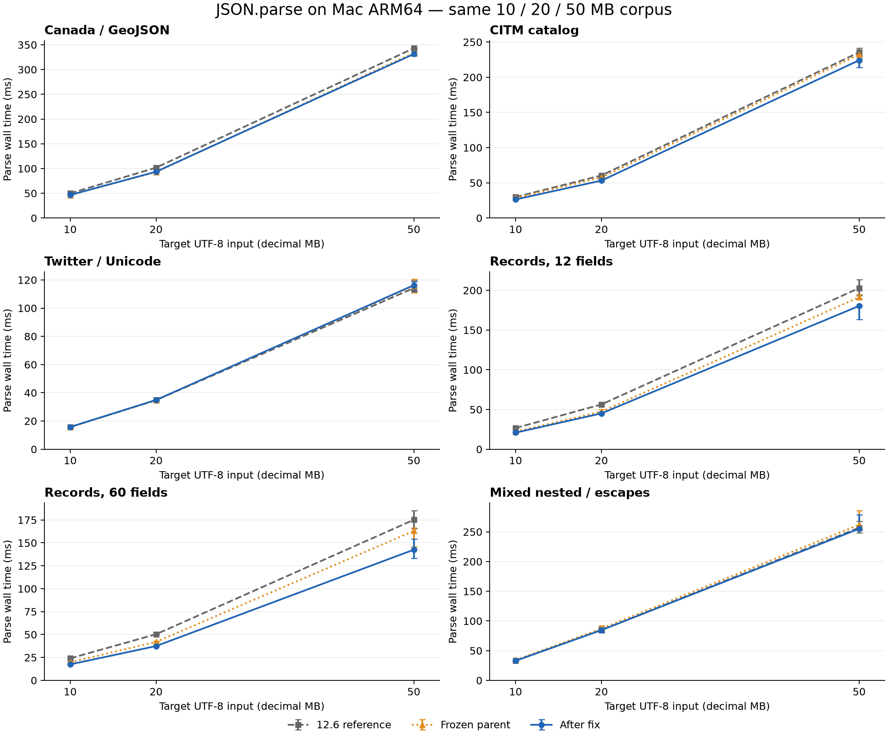

# 混合嵌套 JSON.parse 稳定退化：定位、修复与 Mac ARM64 复测

日期：2026-10-26。修复前冻结父提交为 `c86bda376f83b92962b37c9ec3636d3699bc5fac`，
其中生产解析代码对应 `6f5f120c7`；原始分支参考仍是本地 `12.6` 的
`cd985f42b1e54328dfa52a01149d9350701df5b8`。两者均为 V8 12.6.228.49。
受测最终 d8 的 SHA-256 为 `a2a318a148041755fa71f07260e457bcee2b72c89233983f54c0e4b5548714ce`。

本次生产改动包括两项：

1. [json-parser.h](../src/json/json-parser.h) 中 `ParseJsonObjectProperties<state>`
   从 `V8_INLINE` 改为 `V8_NOINLINE`，让三个状态分别保留独立函数。
2. [json-parser-background.cc](../src/json/json-parser-background.cc) 的工作线程字符串缓存
   直接保存已验证的 `BackgroundJsonNode` 元数据。命中时省去从 `deque` 按索引再取元数据，
   保留每个槽的首项及原缓存槽编号。两个 64 槽缓存由 4 字节索引改为 12 字节元数据，
   每个 worker 增加 1,024 字节缓存存储；原生 tape 仍为每节点 12 字节。

同形对象的直接构建、Map/字段表示检查、输入所有权、后台容器栈和前台软预算沿用原实现。

## 结果与验收

耗时降低为 `1 - 修复后/参考`，正值表示更快。几何平均对六类输入等权计算。

| 目标 MB | 相对修复前加速比 | 相对修复前耗时降低 | 相对 12.6 加速比 | 相对 12.6 耗时降低 |
|---|---|---|---|---|
| 10 | 1.049× | 4.68% | 1.137× | 12.04% |
| 20 | 1.044× | 4.19% | 1.130× | 11.53% |
| 50 | 1.044× | 4.24% | 1.068× | 6.39% |

混合嵌套及同形记录的逐项结果如下。完整 18 项解析表和全部负面结果在后文。

| 输入族 | 目标 MB | 修复前 ms | 修复后 ms | 相对修复前耗时降低 | 12.6 ms | 相对 12.6 耗时降低 | 配对降低范围 |
|---|---|---|---|---|---|---|---|
| 混合嵌套 / 转义 | 10 | 34.271 | 32.958 | 3.83% | 33.167 | 0.63% | 0.12% ～ 4.22% |
| 混合嵌套 / 转义 | 20 | 87.125 | 84.604 | 2.89% | 84.875 | 0.32% | 1.24% ～ 5.01% |
| 混合嵌套 / 转义 | 50 | 262.042 | 255.292 | 2.58% | 256.979 | 0.66% | 0.20% ～ 3.33% |
| 12 字段混合记录 | 10 | 22.105 | 20.792 | 5.94% | 26.645 | 21.97% | 4.94% ～ 6.56% |
| 12 字段混合记录 | 20 | 47.375 | 45.084 | 4.84% | 56.396 | 20.06% | 4.07% ～ 5.68% |
| 12 字段混合记录 | 50 | 191.354 | 180.375 | 5.74% | 202.833 | 11.07% | 4.31% ～ 16.20% |
| 60 字段混合记录 | 10 | 19.688 | 17.438 | 11.43% | 24.062 | 27.53% | 11.02% ～ 11.84% |
| 60 字段混合记录 | 20 | 42.000 | 37.438 | 10.86% | 50.333 | 25.62% | 10.47% ～ 11.11% |
| 60 字段混合记录 | 50 | 163.021 | 142.541 | 12.56% | 175.125 | 18.61% | -3.34% ～ 18.80% |

本轮通过逐项验收：混合三种体积相对修复前均改善；同形记录保留并扩大原收益。
门槛为汇总和配对中位数均须满足：同形记录回退不超过 2%、其他 parse/stringify 不超过 3%、
async 控制不超过 5%；混合相对 `12.6` 的汇总回退不超过 1%。
各项小幅负面结果与所有慢样本仍单列保留。
混合嵌套三档合计 24 次逐轮配对，24 次快于冻结修复前。

## 根因与因果对照

原先强制内联属性解析模板，把递归值分发与普通属性循环重复展开到快速反馈、未知反馈、
失配回退等调用点。按冻结 Mach-O 相邻 text 符号地址估算，UTF-16 `ParseJsonObject`
的范围从原始 `12.6` 的约 1,792 字节扩大到修复前的约 11,116 字节。
混合 10 MB 一次解析记录到 120,378 次对象构建、109,956 次普通属性循环调用，
仅 10,420 次进入同形直接构建且全部成功。因此普通路径的生成代码成本在该输入中很突出。

诊断按以下步骤区分了原因：

- 同二进制关闭同形直接构建，12/60 字段记录约慢 18%/20%，混合嵌套也略慢。
  另一个已冻结的“后台栈修复、无直接构建”版本同样存在混合退化。
- 关闭数值前缀快路径、复用短串探测位置、切换 UTF-16 短串扫描方式，对混合输入的
  探索改善都不足 1%，不足以解决已观察到的退化。这些短串探测/数值前缀变体没有进入生产版本。
- 同一个带诊断选择器的二进制，将普通循环切到独立函数后，混合 10 MB 约降低 3.83%，
  两类同形记录接近持平；这将问题进一步缩小到内联方式与生成代码。
- 最终取消三个模板状态的强制内联。UTF-16 对象分发函数约为 904 字节，三个属性循环
  各约 1,636、3,060、3,872 字节。分发函数与循环的总范围约 9,472 字节，
  普通和快速循环分别执行自己的较小函数体。

这是对当前 Apple clang / Release 构建中内联策略的因果验证；寄存器溢出和各级指令缓存
对收益的具体占比没有单独测量。同形直接构建的检查与分配实现保持在原路径中。

## 未保留的候选与负面结果

以下候选均通过基本结果校验，但没有通过性能门槛。表中正值表示耗时降低。

| 候选，10 MB | 混合嵌套 | 12 字段 | 60 字段 | Twitter |
|---|---|---|---|---|
| 仅提取普通循环 | 3.67% | -8.33% | -5.34% | -2.43% |
| 无反馈对象独立解析 | 2.72% | -2.81% | -0.86% | -2.56% |
| 入口分流并调整短串探测 | 2.92% | -9.59% | -5.11% | -1.34% |

早期探索脚本存在“两版本旋转与奇数轮反转相互抵消”的执行顺序问题。
`diagnostic-switches`、`diagnostic-reuse-probe`、`causal-versions`、
`diagnostic-probe-styles` 作为探索材料保留，不计入正式验收。
修正后的两版本四轮顺序为 AB、BA、BA、AB；三版本在各轮旋转并在完整轮转后反转。
后续因果循环对照、全部候选试跑和正式矩阵使用修正后的工具。

单独取消内联的完整候选在 50 MB 四任务 async 的八轮汇总中仍慢约 6.45%，未通过门槛，
没有作为交付版本。元数据缓存组合另行冻结并从头复测；旧候选的全部样本单独保留。

元数据缓存的四轮 50 MB、四任务试跑中，组合版相对修复前的 12/60 字段耗时仅降低
0.05%/0.28%；同批仅取消内联版为 11.65%/1.06%。这个试跑没有证明缓存单项的
独立稳定墙钟收益。最终验收使用组合版重新冻结后的预定完整矩阵，结论只适用于组合版。
所有候选试跑均未合并进各自正式验收数字。正式矩阵中的负面项如下，
包括汇总耗时为负及逐轮配对范围中的慢样本。

| 输入族 | MB | API | 任务数 | 参考 | 耗时降低（负为减速） | 配对变化中位数 |
|---|---|---|---|---|---|---|
| GeoJSON / Canada | 10 | parse | 1 | 修复前 | -0.95% | -0.27% |
| GeoJSON / Canada | 10 | stringify | 1 | 修复前 | -0.42% | 0.00% |
| GeoJSON / Canada | 20 | parse | 1 | 修复前 | -0.74% | -0.88% |
| GeoJSON / Canada | 20 | stringify | 1 | 修复前 | -0.16% | 0.27% |
| 目录 / CITM | 20 | stringify | 1 | 修复前 | -0.61% | -0.10% |
| 混合嵌套 / 转义 | 20 | stringify | 1 | 修复前 | -0.17% | 0.08% |
| 混合嵌套 / 转义 | 50 | stringify | 1 | 修复前 | -0.68% | 0.13% |
| 60 字段混合记录 | 20 | parseAsync | 4 | 修复前 | -1.26% | 0.29% |
| 60 字段混合记录 | 50 | stringify | 1 | 修复前 | -0.03% | -0.03% |
| Twitter / Unicode | 10 | parse | 1 | 修复前 | -0.67% | -0.94% |
| Twitter / Unicode | 10 | stringify | 1 | 修复前 | -0.34% | 0.01% |
| Twitter / Unicode | 20 | parse | 1 | 修复前 | -0.78% | -1.14% |
| Twitter / Unicode | 20 | parse | 1 | 12.6 | -0.12% | -0.24% |
| Twitter / Unicode | 50 | parse | 1 | 修复前 | -0.29% | -0.66% |
| Twitter / Unicode | 50 | parse | 1 | 12.6 | -1.81% | -1.10% |

Twitter 20 MB 首四轮汇总慢 3.24%，超过 3% 门槛；依照测试前的超门槛复核规则，
对全部三个 Twitter 体积固定补充一次四轮。复核计划先于复核执行冻结，门槛保持不变；
首轮负面没有剔除，以下八轮汇总包含全部样本。

| Twitter MB | 首四轮耗时降低 | 首四轮配对中位数 | 复核四轮耗时降低 | 八轮耗时降低 | 八轮配对中位数 |
|---|---|---|---|---|---|
| 10 | -1.45% | -0.67% | -0.94% | -0.67% | -0.94% |
| 20 | -3.24% | -2.21% | -0.60% | -0.78% | -1.14% |
| 50 | 0.53% | -0.36% | -1.48% | -0.29% | -0.66% |

## 同一批 10/20/50 MB 输入

继续使用 [上一轮报告](json-large-mac-arm64.md) 的全部 18 个实际文件。
`fixtures/manifest.json` 的 SHA-256 为
`58acc9785e8090c8ec8e8fc58c81cc3e607fb50d58fa01c31a02ba03d1d8665e`，
逐文件字节、UTF-16 长度和 SHA-256 均重新核对；没有为修复更换 schema 或简化数据。

六类输入为 Canada GeoJSON、CITM catalog、Twitter / Unicode、12 字段混合记录、
60 字段混合记录，以及含 CJK、emoji、转义键、索引键、类型变化和多级对象/数组的混合嵌套。
前三类继续使用固定提交的 [nativejson-benchmark](https://github.com/miloyip/nativejson-benchmark)
公开种子派生数据。体积为十进制 UTF-8 MB，实际大小见上一轮的逐文件清单。

## 正式测量口径

- 本机 Apple M1 Pro，8 核 CPU、16 GiB 内存、macOS 27.0.1 / build 26A434。
  电源、thermal 状态与负载保留在原始材料中。
- 沿用原 Release GN 参数，Apple clang 21.0.0、MacOSX27.0 SDK、ARM64、`-O3`，
  无 LTO/PGO。修复前与候选参数一致；原始 `12.6` 构建差异继续按上一轮清单记录。
- 统一使用 `--expose-gc --thread-pool-size=4 --max-old-space-size=4096`。
  文件读取、UTF-8 解码、显式计时前 GC、结果校验在 API 区间外；计时内自然 GC 保留。
- 大文件直接复用上一轮冻结的 `benchmark.js`、`common.js`、`conformance.js`，
  三个文件逐字节相同。每个独立进程预热 2 次、计时 9 次，使用进程中位数；
  每个单元的主表值为全部对应进程中位数的中位数。
- parse 采用修复前、修复后、`12.6` 三版本同单元对照；stringify 采用修复前/修复后对照；
  四任务 async 对照采用原 12/60 字段文件。四任务延迟是整批完成时间，使用同一份已读入字符串。
- 所有预热、慢样本与负面结果均保留。引擎构建、下载与绘图不和正式计时重叠。
  CPU/RSS 是含读入、校验和显式 GC 的整进程指标。

大文件正式矩阵共 **528 个进程、4,752 个计时批次**。
完整 parse/stringify 对照各四轮；混合三种体积和四任务 async 控制从本候选开始即固定八轮。
Twitter 三档按照原定超门槛复核规则追加一次四轮，首轮与复核样本全部合并。
没有混入旧候选样本，也没有再次选择性复测 Twitter。
另外有 64 个补充控制进程、1,152 个 API 计时批次；
合计 **592 个正式进程、5,904 个计时批次**。

## 完整 JSON.parse 表

单位 ms。配对范围为修复后相对修复前的逐轮耗时降低范围，不是置信区间。

| 输入族 | 目标 MB | 修复前 ms | 修复后 ms | 相对修复前耗时降低 | 12.6 ms | 相对 12.6 耗时降低 | 配对降低范围 |
|---|---|---|---|---|---|---|---|
| GeoJSON / Canada | 10 | 46.125 | 46.563 | -0.95% | 49.875 | 6.64% | -2.07% ～ 0.18% |
| GeoJSON / Canada | 20 | 92.896 | 93.583 | -0.74% | 101.792 | 8.06% | -1.90% ～ 2.15% |
| GeoJSON / Canada | 50 | 333.771 | 331.333 | 0.73% | 343.042 | 3.41% | -1.49% ～ 2.79% |
| 目录 / CITM | 10 | 28.646 | 26.396 | 7.86% | 29.812 | 11.46% | 6.97% ～ 8.57% |
| 目录 / CITM | 20 | 57.500 | 53.167 | 7.54% | 60.500 | 12.12% | 5.46% ～ 8.30% |
| 目录 / CITM | 50 | 232.334 | 224.125 | 3.53% | 235.479 | 4.82% | 3.42% ～ 7.71% |
| Twitter / Unicode | 10 | 15.625 | 15.730 | -0.67% | 15.771 | 0.26% | -5.59% ～ 0.26% |
| Twitter / Unicode | 20 | 34.604 | 34.875 | -0.78% | 34.833 | -0.12% | -6.80% ～ 0.84% |
| Twitter / Unicode | 50 | 115.916 | 116.250 | -0.29% | 114.187 | -1.81% | -2.19% ～ 5.43% |
| 12 字段混合记录 | 10 | 22.105 | 20.792 | 5.94% | 26.645 | 21.97% | 4.94% ～ 6.56% |
| 12 字段混合记录 | 20 | 47.375 | 45.084 | 4.84% | 56.396 | 20.06% | 4.07% ～ 5.68% |
| 12 字段混合记录 | 50 | 191.354 | 180.375 | 5.74% | 202.833 | 11.07% | 4.31% ～ 16.20% |
| 60 字段混合记录 | 10 | 19.688 | 17.438 | 11.43% | 24.062 | 27.53% | 11.02% ～ 11.84% |
| 60 字段混合记录 | 20 | 42.000 | 37.438 | 10.86% | 50.333 | 25.62% | 10.47% ～ 11.11% |
| 60 字段混合记录 | 50 | 163.021 | 142.541 | 12.56% | 175.125 | 18.61% | -3.34% ～ 18.80% |
| 混合嵌套 / 转义 | 10 | 34.271 | 32.958 | 3.83% | 33.167 | 0.63% | 0.12% ～ 4.22% |
| 混合嵌套 / 转义 | 20 | 87.125 | 84.604 | 2.89% | 84.875 | 0.32% | 1.24% ～ 5.01% |
| 混合嵌套 / 转义 | 50 | 262.042 | 255.292 | 2.58% | 256.979 | 0.66% | 0.20% ～ 3.33% |

图中误差线为各进程中位数的最小到最大范围，不是置信区间；它与表中的逐轮配对变化范围分别记录。

## JSON.stringify 与四任务 JSON.parseAsync 回退检查

stringify 的输入对象在计时外构造；该表只判断本次修复的增量影响。
完整分支 stringify 对比仍保留在上一轮报告中。

| 输入族 | 每个输入 MB | 任务数 | 修复前 ms | 修复后 ms | 耗时降低 | 配对降低范围 |
|---|---|---|---|---|---|---|
| GeoJSON / Canada | 10 | 1 | 19.500 | 19.583 | -0.42% | -1.08% ～ 2.06% |
| GeoJSON / Canada | 20 | 1 | 38.667 | 38.729 | -0.16% | -0.54% ～ 0.43% |
| GeoJSON / Canada | 50 | 1 | 92.229 | 91.875 | 0.38% | -0.23% ～ 0.59% |
| 目录 / CITM | 10 | 1 | 20.604 | 20.583 | 0.10% | -0.40% ～ 0.61% |
| 目录 / CITM | 20 | 1 | 41.062 | 41.312 | -0.61% | -2.25% ～ 1.49% |
| 目录 / CITM | 50 | 1 | 100.875 | 100.750 | 0.12% | -0.69% ～ 1.00% |
| Twitter / Unicode | 10 | 1 | 6.062 | 6.083 | -0.34% | -0.70% ～ 0.66% |
| Twitter / Unicode | 20 | 1 | 12.312 | 12.229 | 0.67% | -0.69% ～ 1.69% |
| Twitter / Unicode | 50 | 1 | 30.583 | 30.312 | 0.89% | -0.27% ～ 1.49% |
| 12 字段混合记录 | 10 | 1 | 14.188 | 14.041 | 1.03% | -4.68% ～ 1.46% |
| 12 字段混合记录 | 20 | 1 | 28.479 | 28.292 | 0.66% | 0.00% ～ 5.05% |
| 12 字段混合记录 | 50 | 1 | 70.813 | 70.667 | 0.21% | -0.63% ～ 0.53% |
| 60 字段混合记录 | 10 | 1 | 12.916 | 12.833 | 0.64% | -1.59% ～ 2.52% |
| 60 字段混合记录 | 20 | 1 | 25.583 | 25.542 | 0.16% | -2.27% ～ 0.48% |
| 60 字段混合记录 | 50 | 1 | 63.479 | 63.500 | -0.03% | -4.07% ～ 0.07% |
| 混合嵌套 / 转义 | 10 | 1 | 25.438 | 25.208 | 0.90% | -2.50% ～ 3.85% |
| 混合嵌套 / 转义 | 20 | 1 | 50.021 | 50.105 | -0.17% | -0.92% ～ 0.17% |
| 混合嵌套 / 转义 | 50 | 1 | 122.917 | 123.750 | -0.68% | -1.60% ～ 4.42% |

| 输入族 | 每个输入 MB | 任务数 | 修复前 ms | 修复后 ms | 耗时降低 | 配对降低范围 |
|---|---|---|---|---|---|---|
| 12 字段混合记录 | 10 | 4 | 91.833 | 86.167 | 6.17% | -18.71% ～ 18.75% |
| 12 字段混合记录 | 20 | 4 | 181.896 | 171.020 | 5.98% | -25.30% ～ 24.04% |
| 12 字段混合记录 | 50 | 4 | 504.042 | 478.917 | 4.98% | -1.29% ～ 13.98% |
| 60 字段混合记录 | 10 | 4 | 74.542 | 72.646 | 2.54% | -11.23% ～ 11.80% |
| 60 字段混合记录 | 20 | 4 | 178.854 | 181.104 | -1.26% | -21.32% ～ 17.35% |
| 60 字段混合记录 | 50 | 4 | 404.375 | 362.688 | 10.31% | -4.46% ～ 18.43% |

20 MB 四任务 async 仍有 21.32% / 25.30% 的单轮慢样本；阶段计时尚未采集。
八轮配对详情和下一步测量要求见 [JSON.parseAsync 长尾诊断 handoff](json-parse-async-stack.md#2026-10-26-后续事项20-mb-四任务-async-单轮长尾)。

**2026-10-27 后续：** 已完成新一轮阶段定位和修复验证。在 macOS ARM64 将对象标记队列
最小局部段容量从 64 调至 256，以减少满段发布的同步开销。20 MB 四任务的 12/60 字段记录总耗时分别降低 15.20%/14.18%，批次 p90 降低 18.90%/16.76%。
另明确保留 CITM 20 MB 同步 parse 约 3.009% 配对中位数回退及部分进程 RSS 峰值上升；
原 3% 门槛未改写为通过。
完整控制、空间代价与正确性证据见 [标记队列批量修复报告](json-parse-async-tail-mac-arm64.md)。
新结果不替换上述历史样本，也不能倒推原 pair=2 的确切阶段原因。

仅取消内联的旧候选数据单独保留如下；八轮值包含全部首轮负面，未通过的 12 字段 50 MB 项促成了后续组合实验。

| 输入族 | MB | 首四轮耗时降低 | 首四轮配对中位数 | 追加四轮耗时降低 | 八轮耗时降低 | 八轮配对中位数 |
|---|---|---|---|---|---|---|
| 12 字段混合记录 | 10 | -0.12% | 0.71% | -3.28% | -2.28% | -1.31% |
| 12 字段混合记录 | 20 | -3.28% | -4.47% | 9.99% | -3.15% | -0.59% |
| 12 字段混合记录 | 50 | -11.48% | -11.53% | 0.57% | -6.45% | -1.79% |
| 60 字段混合记录 | 10 | -2.64% | -1.79% | -2.49% | -1.37% | -0.84% |
| 60 字段混合记录 | 20 | 12.80% | 7.77% | -0.44% | 2.59% | 2.28% |
| 60 字段混合记录 | 50 | -4.82% | -6.49% | 6.76% | -4.10% | -0.20% |

为同时检查 UTF-16 同形记录、Unicode 键及前缀/变化形状，使用前轮微基准生成器补测
单/四任务，sync 与 async 在进程内交替；它们与 18 个大文件的 schema 分别记录。
两版本生成文本和预期结果的完整 UTF-16LE SHA-256 一致。每进程每 API 预热 2 次、计时 9 次，
四轮交换版本顺序，所有预热和慢样本保留。

| 补充输入 | 任务数 | API | 修复前 ms | 修复后 ms | 耗时降低 | 配对中位数 |
|---|---|---|---|---|---|---|
| utf16_records | 1 | sync | 6.000 | 5.229 | 12.85% | 12.23% |
| utf16_records | 1 | async | 8.563 | 8.270 | 3.42% | 3.90% |
| utf16_records | 4 | sync | 28.999 | 25.833 | 10.92% | 11.24% |
| utf16_records | 4 | async | 24.271 | 23.792 | 1.98% | 1.98% |
| unicode_keys | 1 | sync | 7.188 | 6.541 | 8.99% | 9.00% |
| unicode_keys | 1 | async | 8.605 | 8.104 | 5.82% | 6.02% |
| unicode_keys | 4 | sync | 33.812 | 31.104 | 8.01% | 8.12% |
| unicode_keys | 4 | async | 24.229 | 23.729 | 2.06% | 2.56% |
| prefix_shapes | 1 | sync | 6.271 | 6.229 | 0.67% | 0.33% |
| prefix_shapes | 1 | async | 8.083 | 7.687 | 4.91% | 4.91% |
| prefix_shapes | 4 | sync | 24.521 | 24.542 | -0.08% | -0.08% |
| prefix_shapes | 4 | async | 20.792 | 20.271 | 2.51% | 2.02% |
| shape_churn | 1 | sync | 8.395 | 7.980 | 4.96% | 4.96% |
| shape_churn | 1 | async | 10.208 | 9.729 | 4.69% | 4.51% |
| shape_churn | 4 | sync | 32.917 | 31.542 | 4.18% | 4.18% |
| shape_churn | 4 | async | 30.042 | 29.521 | 1.73% | 1.73% |

## 正确性

- 修复后全部 18 个大型输入的完整树指纹，与冻结参考逐项相同。
  键顺序、数组长度、类型、原型、UTF-16 内容和 IEEE-754 数字位模式（含负零）参与校验。
- 每个大型输入的完整 canonical UTF-8 输出字节数与 SHA-256 均一致；
  parseAsync 对同一批文件的完整树结果也一致。每个正式预热/计时输出均在计时后校验。
- 原固定版 [JSONTestSuite](https://github.com/nst/JSONTestSuite) 的 293 个适用用例，
  在新版本 parse、parseAsync 两路共 586 次执行全部通过并与冻结决定/接受树一致。
  其中每路 271 个必选用例、22 个实现自行决定用例；原 25 个非法 UTF-8 字节文件继续单列排除。
- 共 70 项回归检查全部通过，覆盖冻结修复前、修复后 Release、修复后 DCHECK /
  `--verify-heap`，以及移动 GC、同形对象、数值、async 容器栈/生命周期、clone 等原生检查。
  其中 18 项确定性输出与冻结修复前逐字节一致。
- 新增 [parse-mixed-nested.js](../test/json/parse-mixed-nested.js) 含 2,315 次比较：
  转义/Unicode 键值、31/32/33 等边界、类型/形状变化、错误位置，以及
  64/512/2048/4096 层深度的递归到迭代回退。普通、移动 GC、DCHECK 输出均为
  `mixed-nested comparisons=2315 hash=cc7113d`。

- 新增 [parse-native-metadata-cache.js](../test/json/parse-native-metadata-cache.js)，覆盖
  大型 ASCII/UTF-16 输入、短字符串哈希碰撞、空键/空值、键顺序变化、64/66 字段边界
  以及 reviver 的 source 信息。普通、移动 GC 与 DCHECK 的输出均与冻结参考一致：
  `native-metadata-cache comparisons=6 hash=691c7ff3`。

## 证据与复现

- 汇总数据：[mixed-fix-mac-arm64-20261026.json](../tools/json_large/evidence/mixed-fix-mac-arm64-20261026.json)。
- 复现工具：[tools/json_large](../tools/json_large/README.md)。
- 原始实验目录：`/Users/james/projects/v8/v8-standalone/out/json-mixed-fix-20261026-130reian`。
- 外部校验归档：`/Users/james/projects/v8/v8-standalone-worktree-docs/2026-10-26/json-mixed-parse-fix-c86bda376-130reian`。
  `verification.json` 记录最终本地提交、归档 SHA-256 和逐文件校验结果。
- `binaries/`、`sources/`、`manifests/` 保留冻结基线、失败候选、诊断选择器和最终构建。
  `results/*-raw.jsonl`、`profiles/`、`logs/` 保留所有样本、采样、计数与校验输出。
- 用新的 tag 复测，保留原始文件；例如 `compare.py --out EXTRACTED --tag replay-parse
  --labels before metadata v12 --pairs 4 --samples 9`。设置 `V8_JSON_ROOT` 可选择重放仓库。

性能结论限于本机 Mac ARM64 和记录的构建参数。
