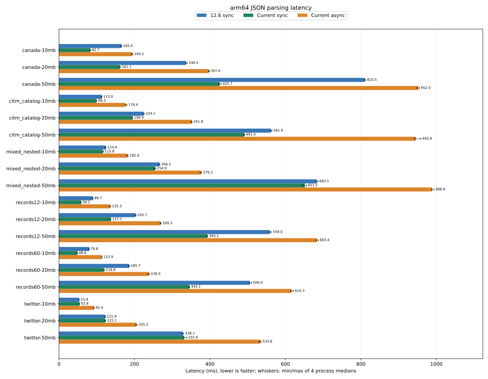
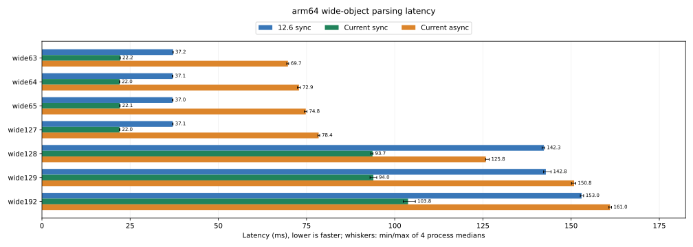
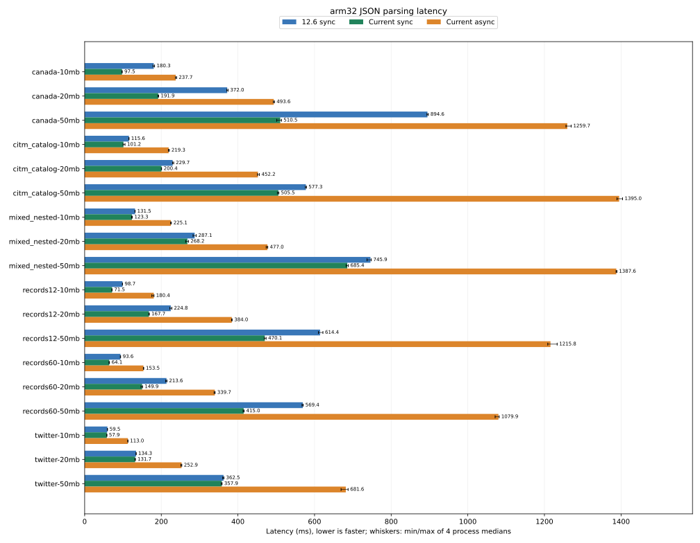
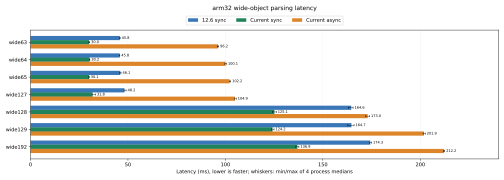

# OnePlus 6 Android JSON.parse / JSON.parseAsync 性能报告

同步接口在两种 ABI 上均取得明确收益；异步完成耗时及四任务组结果见分项表。

| ABI | 同步等权几何平均加速 | 对应耗时降低 | 单任务异步/当前同步完成耗时比 |
|---|---:|---:|---:|
| arm64 | 1.329× | 24.76% | 1.882× |
| arm32 | 1.280× | 21.90% | 2.243× |

需要保留的负结果：arm64 的 Twitter 三档同步耗时分别增加约 0.94%、0.18%、1.05%；arm32 18 项同步均较快。单任务异步的完成耗时在本套大文件中均高于当前同步。

arm32 的 50 MB 四任务组开销明显放大：records12 串行同步 2079.420 ms、并发异步 8313.127 ms；records60 分别为 1764.803 ms 和 7245.187 ms。本轮未采集分配/GC/前台构建的阶段剖析，不能仅凭完成时间确定放大根因。

128 属性字典对象边界仍有明显成本：当前 arm64 从 127 属性约 22.0 ms 升至 128 属性约 93.7 ms，arm32 从约 31.8 ms 升至约 125.1 ms。这是输入宽度边界的观测；本次分支比较包含所有累计改动，不是对单个优化补丁的归因。

实验创建时间：2026-11-01 21:45:17.259090；矩阵完成时间：2026-11-02T00:25:07.179145+08:00。文件名使用实验开始日期。

原始 12.6：`cd985f42b1e54328dfa52a01149d9350701df5b8`；扩展分支：`04d724ae860fb586994e4cc5fbbfa19f7217cba3`。设备序列号 885841c1，Android 15，root ADB。

同一设备分别运行 arm64 和 arm32。CPU affinity 为 f0，线程池 4，计时期间 policy0/policy4 governor 为 performance，结束后恢复。输入读取和完整结果校验在 API 计时外；每进程 2 次预热、9 次测量，共 4 个进程配对。同步分支顺序 AB、BA、BA、AB。表内耗时为进程中位数的中位数；SVG 误差线显示四个进程中位数的最小值至最大值，并非置信区间。温度和频率及每个样本见原始数据。遥测三行依次为 battery/temp（0.1°C）、policy4/scaling_cur_freq（kHz）、thermal_zone0/temp（0.001°C，传感器名 aoss0-usr）。performance governor 不代表硬锁频，系统温控仍然生效；这是持续运行负载的设备结果。

构建使用 Android NDK 27.3.13750724，Release/official 配置，禁用 ICU 和 WebAssembly，内置启动快照；两分支使用对应 ABI 的相同参数与运行库。Mac 主机通过本地 GN 适配器生成构建并在手机执行目标快照生成器，运行时源码无补丁。精确参数见 frozen.json，编译器版本与哈希见 toolchain.json。

原始 12.6 无 JSON.parseAsync。异步列使用扩展分支，完成耗时包含提交至 Promise 完成；提交耗时已包含在完成耗时内。4 jobs 对比为四次串行同步与四次并发异步的整组耗时。

数据为六种输入族在 10/20/50 十进制 MB 附近的历史语料；Canada、CITM、Twitter 为完整种子重复数组，另有 records12、records60、mixed_nested。[语料来源固定记录](../tools/json_large/source-pins.json)与[生成脚本](../tools/json_large/generate.py)随仓库保留。不能把本套重复结构的结果直接推广到所有生产 JSON。

## arm64 大文件

18 场景等权几何平均加速 **1.329×**，对应耗时降低 **24.76%**。

| 输入 | 12.6 同步 ms | 当前同步 ms | 同步加速 | 当前异步完成 ms | 异步提交 ms | 异步/同步 |
|---|---:|---:|---:|---:|---:|---:|
| canada-10mb | 165.015 | 82.655 | 1.996× | 194.155 | 4.968 | 2.349× |
| canada-20mb | 336.468 | 161.055 | 2.089× | 396.962 | 10.891 | 2.465× |
| canada-50mb | 810.547 | 425.716 | 1.904× | 951.986 | 24.576 | 2.236× |
| citm_catalog-10mb | 113.040 | 98.342 | 1.149× | 176.383 | 8.980 | 1.794× |
| citm_catalog-20mb | 224.130 | 194.907 | 1.150× | 351.816 | 19.374 | 1.805× |
| citm_catalog-50mb | 561.862 | 490.990 | 1.144× | 945.778 | 47.964 | 1.926× |
| mixed_nested-10mb | 123.390 | 115.751 | 1.066× | 182.013 | 9.108 | 1.572× |
| mixed_nested-20mb | 266.175 | 254.874 | 1.044× | 376.338 | 17.706 | 1.477× |
| mixed_nested-50mb | 683.093 | 651.537 | 1.048× | 988.841 | 44.076 | 1.518× |
| records12-10mb | 89.668 | 58.209 | 1.540× | 135.325 | 5.077 | 2.325× |
| records12-20mb | 202.744 | 137.121 | 1.479× | 269.301 | 9.786 | 1.964× |
| records12-50mb | 558.996 | 393.076 | 1.422× | 683.443 | 25.366 | 1.739× |
| records60-10mb | 79.825 | 48.560 | 1.644× | 113.918 | 4.928 | 2.346× |
| records60-20mb | 185.710 | 118.786 | 1.563× | 238.025 | 9.582 | 2.004× |
| records60-50mb | 505.998 | 345.070 | 1.466× | 616.318 | 26.293 | 1.786× |
| twitter-10mb | 53.447 | 53.947 | 0.991× | 92.430 | 7.456 | 1.713× |
| twitter-20mb | 121.885 | 122.103 | 0.998× | 205.177 | 15.446 | 1.680× |
| twitter-50mb | 328.139 | 331.599 | 0.990× | 533.823 | 39.735 | 1.610× |

同步耗时变长的场景：twitter-10mb 增加 0.94%；twitter-20mb 增加 0.18%；twitter-50mb 增加 1.05%

异步/当前同步完成耗时比的等权几何平均为 1.882×；该比值小于 1 表示异步完成更快，大于 1 表示完成更慢。

### 四任务组耗时

| 输入 | 串行同步 ms | 并发异步 ms | 异步/同步 |
|---|---:|---:|---:|
| records12-10mb | 292.133 | 334.102 | 1.144× |
| records12-20mb | 711.742 | 782.332 | 1.099× |
| records12-50mb | 1741.341 | 1987.316 | 1.141× |
| records60-10mb | 257.696 | 287.249 | 1.115× |
| records60-20mb | 583.949 | 589.246 | 1.009× |
| records60-50mb | 1483.138 | 1533.957 | 1.034× |

### 宽对象

每次解析输入为同形对象数组，对象数为 floor(524288 / 属性数)，字段值为小整数，ASCII 键重复使用。每个宽度单独比较两分支；不同宽度的输入字节数并不完全相同。

| 属性数 | 12.6 同步 ms | 当前同步 ms | 同步加速 | 当前异步 ms |
|---:|---:|---:|---:|---:|
| 63 | 37.202 | 22.190 | 1.677× | 69.726 |
| 64 | 37.064 | 22.021 | 1.683× | 72.860 |
| 65 | 37.014 | 22.075 | 1.677× | 74.783 |
| 127 | 37.079 | 22.001 | 1.685× | 78.432 |
| 128 | 142.280 | 93.709 | 1.518× | 125.817 |
| 129 | 142.829 | 93.951 | 1.520× | 150.832 |
| 192 | 152.952 | 103.783 | 1.474× | 161.023 |

## arm32 大文件

18 场景等权几何平均加速 **1.280×**，对应耗时降低 **21.90%**。

| 输入 | 12.6 同步 ms | 当前同步 ms | 同步加速 | 当前异步完成 ms | 异步提交 ms | 异步/同步 |
|---|---:|---:|---:|---:|---:|---:|
| canada-10mb | 180.327 | 97.506 | 1.849× | 237.688 | 6.097 | 2.438× |
| canada-20mb | 372.004 | 191.874 | 1.939× | 493.629 | 12.052 | 2.573× |
| canada-50mb | 894.615 | 510.505 | 1.752× | 1259.702 | 27.950 | 2.468× |
| citm_catalog-10mb | 115.616 | 101.211 | 1.142× | 219.309 | 12.039 | 2.167× |
| citm_catalog-20mb | 229.702 | 200.394 | 1.146× | 452.204 | 23.691 | 2.257× |
| citm_catalog-50mb | 577.320 | 505.540 | 1.142× | 1395.023 | 60.383 | 2.759× |
| mixed_nested-10mb | 131.505 | 123.275 | 1.067× | 225.063 | 11.261 | 1.826× |
| mixed_nested-20mb | 287.065 | 268.198 | 1.070× | 477.020 | 20.751 | 1.779× |
| mixed_nested-50mb | 745.911 | 685.369 | 1.088× | 1387.626 | 53.697 | 2.025× |
| records12-10mb | 98.743 | 71.459 | 1.382× | 180.388 | 6.104 | 2.524× |
| records12-20mb | 224.789 | 167.713 | 1.340× | 384.010 | 11.618 | 2.290× |
| records12-50mb | 614.434 | 470.087 | 1.307× | 1215.769 | 28.698 | 2.586× |
| records60-10mb | 93.575 | 64.067 | 1.461× | 153.454 | 5.947 | 2.395× |
| records60-20mb | 213.573 | 149.935 | 1.424× | 339.683 | 11.335 | 2.266× |
| records60-50mb | 569.392 | 415.006 | 1.372× | 1079.925 | 28.130 | 2.602× |
| twitter-10mb | 59.451 | 57.870 | 1.027× | 112.972 | 9.813 | 1.952× |
| twitter-20mb | 134.259 | 131.723 | 1.019× | 252.938 | 20.081 | 1.920× |
| twitter-50mb | 362.456 | 357.890 | 1.013× | 681.581 | 48.098 | 1.904× |

同步耗时变长的场景：本轮未观察到。

异步/当前同步完成耗时比的等权几何平均为 2.243×；该比值小于 1 表示异步完成更快，大于 1 表示完成更慢。

### 四任务组耗时

| 输入 | 串行同步 ms | 并发异步 ms | 异步/同步 |
|---|---:|---:|---:|
| records12-10mb | 350.670 | 662.208 | 1.888× |
| records12-20mb | 808.737 | 1817.896 | 2.248× |
| records12-50mb | 2079.420 | 8313.127 | 3.998× |
| records60-10mb | 312.963 | 596.151 | 1.905× |
| records60-20mb | 720.183 | 1605.387 | 2.229× |
| records60-50mb | 1764.803 | 7245.187 | 4.105× |

### 宽对象

每次解析输入为同形对象数组，对象数为 floor(524288 / 属性数)，字段值为小整数，ASCII 键重复使用。每个宽度单独比较两分支；不同宽度的输入字节数并不完全相同。

| 属性数 | 12.6 同步 ms | 当前同步 ms | 同步加速 | 当前异步 ms |
|---:|---:|---:|---:|---:|
| 63 | 45.834 | 29.995 | 1.528× | 96.228 |
| 64 | 45.760 | 30.209 | 1.515× | 100.147 |
| 65 | 46.085 | 30.069 | 1.533× | 102.163 |
| 127 | 48.243 | 31.849 | 1.515× | 104.899 |
| 128 | 164.576 | 125.145 | 1.315× | 173.006 |
| 129 | 164.659 | 124.173 | 1.326× | 201.876 |
| 192 | 174.325 | 136.936 | 1.273× | 212.180 |

## 正确性检查

两 ABI 的当前分支分别执行五套既有回归：20,320 个数字案例（含 306 个独立精确舍入检查）、数字扫描/非法输入/reviver source、5,224 个字符串块边界、异步宽对象及字典对象。详细退出状态和输出见 regressions.jsonl。六组基础检查覆盖两 ABI 的基线同步、当前同步和当前异步。性能矩阵每次结果均执行完整树指纹校验。

## 设备运行记录

计时前后遥测范围：battery_C 31.0–42.5；policy4_kHz 2803200.0–2803200.0；aoss0_usr_C 35.2–63.9。这些是进程前后采样，不能证明进程内瞬时频率不变。原 CPU governor 已在矩阵结束后恢复。

## 证据与复现

实验目录：`/Users/james/projects/v8/v8-standalone/out/json-android-20261101`。`protocol.json` 记录输入大小和哈希；`frozen.json` 记录提交、构建参数、二进制与运行库 SHA-256、设备端哈希；`raw.jsonl` 保留全部 696 个进程的 9 次样本、预热、计时外完整结果校验和设备遥测；`smoke.jsonl` 为两 ABI 同步/异步合法与非法输入检查；`run.py` 为测量入口，`report.py` 从完整数据生成本报告和 SVG。

本报告是该设备、该构建配置与该语料的测量；耗时包含自然分配和 GC。异步完成时间不能代表主线程阻塞时间，提交时间也不能覆盖后续前台构建切片。

[机器可读结果](../tools/json_large/evidence/json-parse-android-oneplus6-20261101.json)
