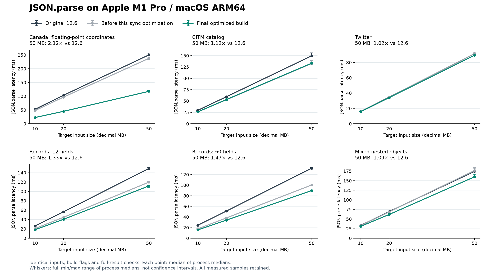

# JSON.parse / JSON.parseAsync 最终性能对比报告

日期：2026-10-29。平台：Apple M1 Pro，macOS ARM64。最终实现 `blockscan`，源码基于 `3d4e3d8e5`。本报告中的最终比较均来自相同输入、相同构建参数、相同完整结果校验的全新测量轮次。

**结论：原定数字优化、回退控制与异步目标均通过验收；附加 ASCII 先行目标未完全达到。** 18 个大文件同步场景相对原始 `12.6` 的等权几何平均加速为 **1.345×**，等价于几何平均耗时降低 **25.65%**；相对本轮同步优化前为 **1.192×**。不能把相对 `12.6` 的全部差异归功于本次改动，逐阶段比较见下表。

[机器可读完整结果](../tools/json_large/evidence/json-parse-final-mac-arm64-20261029.json) · [原异步阶段报告](json-parse-async-wide-keys.md)

## 1. 比较对象与验收门槛

| 标签 | 含义 |
|---|---|
| `v12_6` | 本地原始 `12.6`，提交 `cd985f42b1e54328dfa52a01149d9350701df5b8`；无源码补丁，干净工作区与构建无待办均已复核。 |
| `flatlocal` | 本轮同步改动前；异步实现与最终版相同，用于隔离新增同步优化。这个中间版本本身未通过原异步阶段全部控制门槛，不是交付版本。 |
| `flatfloat` | 已通过原异步目标的阶段版本，增加 fast_float 转换后端，但尚未合并数字扫描。 |
| `blockscan` | 最终实现：扁平宽对象异步构建 + 保留小整数热路径的同步扫描/转换合并 + 同步长字符串 64 字节扫描。 |

同步预设目标：`short_fractions`、`unique_doubles` 单任务，以及 Canada 10/20/50 MB，均相对 `flatlocal` 至少减少 20% 耗时。所有同步控制相对 `flatlocal` 和 `flatfloat` 都不得回退超过 3%。原异步目标：64/65 字段、两类值、1/4 任务的 8 项场景，相对任务开始基线 `3d4e3d8e5` 至少减少 10%；同步/63 字段控制限 3%，其他异步控制限 5%。每项要求“进程中位数的中位数之比”和“配对变化的中位数”同时通过。

## 2. 改动与技术依据

异步构建继续使用现有 BuildSmallValue、键缓存和局部句柄。递归子树维持 128 物理节点、深度 16 的限制；另外允许深度恰为 1、最多 128 字段的扁平对象走同一构建器，最多 257 物理节点。整个对象须放入当前切片剩余 64K 工作预算，宽对象完成后立即检查 2 ms 软时限。深层/更宽对象和需要 reviver source 的解析保留原可恢复路径。2 ms 不是硬实时保证，分配和 GC 仍可能延长任务。

同步数字处理引入固定的 fast_float 8.3.2，合法非小整数通过 JSON 格式的 from_chars_advanced 完成扫描和转换，避免原完整数字扫描后再次转换时的重复遍历。保留原小整数快路径，并把所有非小整数状态移入 V8_NOINLINE FinishJsonNumber。ARM64 反汇编确认小整数入口恢复为 32 字节栈帧，参数顺序保持既有寄存器，避免上一候选 48 字节栈帧给每个小整数增加保存/恢复成本。

长字符串另外增加同步专用 64 字节 NEON 块扫描；只对整块没有控制字符、引号或反斜杠的数据推进游标，并累计已接受块的 UTF-16 宽度。遇到特殊字符或尾部不足一块时交给现有扫描器精确定位。后台 worker 原扫描器保持不变；非 NEON 平台直接使用既有实现。新增 5,224 项边界/原始 surrogate/转义/非法控制字符检查，与旧基线输出完全一致，Release、DCHECK 和 stress-compaction 均通过。

非法数字退回原扫描器，因此错误消息、错误位置和 reviver source 仍使用既有语义。特别处理 fast_float 对 `1e` / `1e+` 返回合法前缀的行为；溢出与下溢保留带符号 Infinity/zero，`-0`、精确舍入和 Smi 表示选择均有独立检查。非法输入可能重扫，合法输入是这次吞吐优化的目标。通用 Number/StringToDouble 和异步 worker 数字转换未改动。

参考：[上游 V8 conversions.cc](https://raw.githubusercontent.com/v8/v8/main/src/numbers/conversions.cc) 已采用 fast_float；[固定 fast_float 源码](https://github.com/fastfloat/fast_float/tree/42f254836ee416ffcf2f4e6576260003ac33d48c) 和 [数值转换论文](https://arxiv.org/abs/2101.11408) 提供算法依据。本仓库导入的上游头文件无修改，三份上游许可证随附，发行包增加 MIT 许可文件。库自述性能不作为本报告的 V8 性能证据。

代码入口：[异步宽对象构建](../src/json/json-parser-async.cc)、[同步数字扫描](../src/json/json-parser.cc)、[数值后端](../src/json/json-number-parser.cc)、[长字符串块扫描](../src/json/json-parser-background.cc)。新增回归用例位于 test/json/parse-async-wide-keys.js、parse-number-backend.js、parse-number-scan.js、parse-string-blocks.js，GC 用例位于 test/cctest/test-json-async.cc。

## 3. 同步大文件：直接对比 12.6

表中均为一次同步 JSON.parse 的 ms。文件大小为十进制目标 MB，准确字节数见原始数据。加速比 = 旧耗时 / 新耗时；降低率 = 1 − 新耗时 / 旧耗时。正值表示改善。

Canada、CITM catalog、Twitter 来自 nativejson-benchmark 的固定种子文档；将完整的紧凑种子重复放入数组，生成约 10/20/50 MB 输入。records12、records60 和 mixed_nested 是确定性合成负载。这里不是 18 份互不相关的生产样本，重复结构会影响形状缓存与分配行为。原始来源和校验和见 [source-pins.json](../tools/json_large/source-pins.json)，构造方法见 [generate.py](../tools/json_large/generate.py)。

| 输入族 | MB | 12.6 ms | 最终 ms | 对 12.6 加速 | 对 12.6 降低 | 对本轮前降低 | 对阶段版降低 |
|---|---:|---:|---:|---:|---:|---:|---:|
| canada | 10 | 52.500 | 22.625 | 2.320× | 56.90% | 52.84% | 16.78% |
| canada | 20 | 103.479 | 45.042 | 2.297× | 56.47% | 53.46% | 13.90% |
| canada | 50 | 250.167 | 117.750 | 2.125× | 52.93% | 50.45% | 13.53% |
| citm_catalog | 10 | 29.667 | 26.208 | 1.132× | 11.66% | -0.16% | -0.16% |
| citm_catalog | 20 | 59.375 | 53.250 | 1.115× | 10.32% | -0.91% | -0.75% |
| citm_catalog | 50 | 149.667 | 133.354 | 1.122× | 10.90% | -0.49% | -0.39% |
| mixed_nested | 10 | 33.375 | 30.916 | 1.080× | 7.37% | 5.42% | 1.72% |
| mixed_nested | 20 | 69.480 | 61.875 | 1.123× | 10.94% | 10.05% | 4.50% |
| mixed_nested | 50 | 174.250 | 160.021 | 1.089× | 8.17% | 9.29% | 5.77% |
| records12 | 10 | 26.396 | 18.167 | 1.453× | 31.18% | 12.18% | 4.38% |
| records12 | 20 | 56.437 | 40.438 | 1.396× | 28.35% | 9.59% | 3.58% |
| records12 | 50 | 149.042 | 111.709 | 1.334× | 25.05% | 6.75% | 1.14% |
| records60 | 10 | 24.458 | 15.750 | 1.553× | 35.60% | 11.06% | 4.06% |
| records60 | 20 | 51.146 | 34.125 | 1.499× | 33.28% | 10.69% | 4.15% |
| records60 | 50 | 132.000 | 89.813 | 1.470× | 31.96% | 10.52% | 3.49% |
| twitter | 10 | 15.938 | 15.688 | 1.016× | 1.57% | 1.57% | 1.31% |
| twitter | 20 | 34.750 | 34.041 | 1.021× | 2.04% | 1.74% | 0.18% |
| twitter | 50 | 91.416 | 89.480 | 1.022× | 2.12% | 2.30% | 0.88% |



[下载 SVG 图](images/json-parse-final-mac-arm64.svg) · [下载 PNG 图](images/json-parse-final-mac-arm64.png)

图和表的总体指标对 18 个场景等权，不按字节量或耗时加权。它描述这套测试集，不是任意生产 JSON 的预期加速。Canada 是浮点坐标密集负载，能明显受益于数字转换；字符串、分配或 GC 占主导的输入，新增数字优化收益会较小。

## 4. 数字、字符串与小整数控制

微基准先用候选校准每批重复次数，目标至少 20 ms，随后所有版本使用相同次数。下表单位是每个重复组的 ms：jobs=4 表示组内 4 次串行同步调用。每批结果保留到计时结束，逐值验证后清空，计时包含自然 GC。它是固定批次吞吐测量，不等同于独立单次调用延迟。

| 用例 | jobs | 12.6 ms | 最终 ms | 对 12.6 降低 | 对本轮前降低 | 对阶段版降低 |
|---|---:|---:|---:|---:|---:|---:|
| dense_unicode | 1 | 2.4028 | 2.3102 | 3.85% | 0.10% | -0.10% |
| dense_unicode | 4 | 10.0763 | 9.5833 | 4.89% | 0.14% | -0.15% |
| emoji_lone | 1 | 0.8878 | 0.4493 | 49.39% | 11.64% | 11.56% |
| emoji_lone | 4 | 3.6818 | 1.8788 | 48.97% | 12.06% | 12.44% |
| fragmented_128 | 1 | 8.4584 | 4.7459 | 43.89% | 29.43% | 16.37% |
| fragmented_128 | 4 | 34.8335 | 19.3125 | 44.56% | 30.41% | 17.16% |
| fragmented_numbers | 1 | 9.0541 | 4.7125 | 47.95% | 29.93% | 15.53% |
| fragmented_numbers | 4 | 36.4795 | 19.5000 | 46.55% | 29.36% | 16.06% |
| integer12 | 1 | 4.6542 | 1.9792 | 57.48% | 45.99% | 21.03% |
| integer12 | 4 | 19.0417 | 7.9793 | 58.10% | 45.65% | 20.76% |
| integer12_utf16 | 1 | 6.0299 | 4.0863 | 32.23% | 30.34% | 9.73% |
| integer12_utf16 | 4 | 23.3333 | 15.5000 | 33.57% | 30.89% | 9.65% |
| integer15 | 1 | 5.3842 | 2.1528 | 60.02% | 50.58% | 20.38% |
| integer15 | 4 | 22.5278 | 8.9515 | 60.26% | 50.59% | 19.79% |
| integers | 1 | 1.8510 | 1.5609 | 15.67% | -2.53% | 1.32% |
| integers | 4 | 7.4010 | 6.2916 | 14.99% | -2.54% | -0.58% |
| long_ascii | 1 | 1.6198 | 0.4754 | 70.65% | 5.55% | 4.11% |
| long_ascii | 4 | 6.7045 | 1.9925 | 70.28% | 5.65% | 7.88% |
| long_strings | 1 | 1.6910 | 1.6945 | -0.21% | 1.21% | 0.20% |
| long_strings | 4 | 6.9582 | 6.9862 | -0.40% | 0.79% | 1.37% |
| long_unicode | 1 | 1.6134 | 0.4298 | 73.36% | 17.91% | 17.60% |
| long_unicode | 4 | 5.8638 | 1.4615 | 75.08% | 20.35% | 20.28% |
| short_ascii | 1 | 2.1170 | 1.8720 | 11.57% | -0.05% | 0.53% |
| short_ascii | 4 | 7.8993 | 6.9201 | 12.40% | 0.00% | 0.15% |
| short_exponents | 1 | 4.2375 | 1.9291 | 54.48% | 40.91% | 19.97% |
| short_exponents | 4 | 17.0695 | 7.7015 | 54.88% | 41.14% | 19.40% |
| short_fractions | 1 | 3.5720 | 1.7728 | 50.37% | 34.36% | 20.67% |
| short_fractions | 4 | 14.0487 | 7.1737 | 48.94% | 32.26% | 18.73% |
| short_fractions_utf16 | 1 | 4.6719 | 3.6016 | 22.91% | 23.84% | 10.02% |
| short_fractions_utf16 | 4 | 19.2915 | 14.8125 | 23.22% | 22.59% | 10.68% |
| short_unicode | 1 | 2.2210 | 2.0683 | 6.88% | 1.49% | 0.67% |
| short_unicode | 4 | 8.5833 | 7.4833 | 12.82% | 0.00% | 0.66% |
| smi_records | 1 | 13.2013 | 10.9790 | 16.83% | 0.57% | 0.51% |
| smi_records | 4 | 50.5830 | 41.5000 | 17.96% | 0.75% | 1.24% |
| sparse_ascii | 1 | 1.5387 | 0.9494 | 38.30% | 0.11% | 0.41% |
| sparse_ascii | 4 | 6.4167 | 4.0173 | 37.39% | -0.87% | -0.78% |
| ten_digit_ints | 1 | 4.3917 | 2.1104 | 51.95% | 39.52% | 18.96% |
| ten_digit_ints | 4 | 17.0068 | 8.1388 | 52.14% | 39.71% | 18.78% |
| unique_doubles | 1 | 9.4614 | 2.8095 | 70.31% | 66.68% | 20.54% |
| unique_doubles | 4 | 37.9582 | 11.2917 | 70.25% | 66.54% | 20.06% |

小整数并非零成本变化：正式纯整数数组控制相对本轮前的变化为 jobs=1: -2.53% / jobs=4: -2.54%。它们在 3% 门槛内，所有数值均保留在表中；不能把浮点收益外推成所有数字输入同等获益。

## 5. 最终二进制的异步复核

原 `12.6` 不提供 JSON.parseAsync，因此异步接口对照任务开始基线 `3d4e3d8e5`。这组复核使用最终 blockscan 二进制，未与早先 flatfloat 阶段样本混合。56 项边界控制和 54 项大文件控制全部通过。下表为原 8 项目标；四任务测量从同时提交到全部完成的总墙钟时间。

| 字段数 | 任务数 | 类型 | 开始基线 ms | 最终 ms | 汇总降低 | 配对降低中位数 |
|---:|---:|---|---:|---:|---:|---:|
| 64 | 1 | mixed | 23.896 | 18.459 | 22.75% | 22.71% |
| 64 | 1 | smi | 22.812 | 17.292 | 24.20% | 23.06% |
| 64 | 4 | mixed | 70.395 | 48.979 | 30.42% | 30.66% |
| 64 | 4 | smi | 60.521 | 38.583 | 36.25% | 36.34% |
| 65 | 1 | mixed | 24.562 | 19.896 | 19.00% | 19.20% |
| 65 | 1 | smi | 23.167 | 18.666 | 19.43% | 19.50% |
| 65 | 4 | mixed | 68.708 | 50.000 | 27.23% | 28.21% |
| 65 | 4 | smi | 58.416 | 39.230 | 32.85% | 32.97% |

附加筛选预期的明确例外：64 字节扫描的先行比较中，long_ascii 单任务汇总改善 3.735%、配对改善 5.195%，未同时达到后来额外加入的 5% 字符串目标。此预期未被宣称完成。正式计时前记录 pilot-disposition.json，公开决定继续验证原定数字目标和全部回退门槛；未重试该先行样本，未降低任何 3%/5% 回退控制线。

## 6. 正确性、噪声与被拒绝的尝试

- 最终版 34 项 Release + 34 项 DCHECK/verify-heap 检查通过，涵盖原 JSON 用例、并发/生命周期、切片之间强制 GC、增量标记、压缩与 minor-ms。
- 宽键测试 33 个对照，包含边界宽度、UTF-16、重复/转义/索引/空键、嵌套、reviver、独立 double 字段和 34,000 字段对象。
- 新数字测试 20,320 个输入、101,600 次位值检查，含 306 个用 BigInt 独立生成的精确中点/邻值、subnormal、溢出、下溢、负零及 8,192 位数字。原 Number 转换作为额外对照，未被此改动替换。
- 新扫描测试比较 1,221 项精确错误结果、60 项 reviver 数字值/source，另覆盖 JSON.rawJSON 原文与错误语义。
- 18 个完整大文件规范输出 SHA-256 和整棵树指纹一致；JSONTestSuite 同步/异步合计 586 项通过。每个性能样本的每个完整结果都在计时外验证。

被拒绝候选保留在证据目录：cachekeys 未满足全部 10% 目标；batchkeys 在大文件四任务控制出现重复退化；widebatch、flatlocal 单独版本未通过原同步控制。首次同步扫描融合 fused 虽让浮点场景进一步减少约 21% 耗时，但整数数组稳定回退约 7.77%，因此拒绝；32→48 字节栈帧是随后代码生成修复的依据。中间 finish 仅检查汇编，未计入性能对比。hotfinish 恢复了小整数热路径，但最终八轮中 long_ascii 单任务对阶段版配对回退 4.263%，long_unicode 四任务对本轮前/阶段版汇总回退 7.605%/3.525%，因此仍拒绝。最终 blockscan 在此基础上真正减少长字符串的循环检查和宽度归约，重新执行整套独立测量，未复用失败候选的样本。


早期基线 A/A 和 GC 诊断已证明这台机器存在 GC 双峰，单对可有约 11.7% 差异；这些诊断不替代未插桩正式数据，也未用来豁免失败门槛。阶段版的 CITM 10 MB 四任务首轮也曾回退约 8.3%，按原计划整族补测后合并回退 3.26%，原样保留在阶段报告。没有按速度、GC 类型或顺序删样本。

进程资源指标作为补充保留。下表是 50 MB 场景的进程峰值 RSS 中位数（MiB），包含输入加载、结果保留、校验和 GC；不能解释为解析器单次分配量。

| 输入族 | 12.6 RSS MiB | 最终 RSS MiB |
|---|---:|---:|
| canada | 209.9 | 211.3 |
| citm_catalog | 237.3 | 237.9 |
| mixed_nested | 274.2 | 274.5 |
| records12 | 184.6 | 186.0 |
| records60 | 160.0 | 160.3 |
| twitter | 196.9 | 197.4 |

## 7. 方法、构建与证据复现

最终测量共 **1,816 个独立计时进程、16,344 个计时批次**，不包含校准、先行筛选、源数据生成和正确性检查，也不包含已完成的原异步阶段 1,024 个正式进程。每进程预热 2 次、计时 9 次。同步四版本采用 Williams 顺序 `[0,1,3,2] / [1,2,0,3] / [2,3,1,0] / [3,0,2,1]`；两版本采用 AB/BA/BA/AB，相邻独立进程配对。场景块使用固定种子打乱。正式计时期间未并行运行本任务的编译、测试或其他性能测量。

默认四轮；预先规定的控制补测只执行一次，整个微基准集合或整个大文件输入族追加四轮，并合并全部样本。已知敏感的 12 字段 mixed 同步四任务固定八轮，不继续重试。目标失败不靠选取样本补救。最终性能属于本机 Release 构建，不外推 Android、x64 或另一套 GC/堆参数。

配置：macOS 27.0.1（26A434）ARM64，Apple Clang 21.0.0（clang-2100.3.34.2）/ SDK 27.0，deployment target 11，Release -O3，无 LTO/PGO；系统 libc++，i18n/Wasm/sandbox 关闭。所有测量使用 `--expose-gc --thread-pool-size=4 --max-old-space-size=4096`。两端 GN args SHA-256 相同：`9d3f09d82c98da7ffdc8e573f4ec9893e22288819e33e9d7217270e8c715131c`。实际编译参数与 SDK 路径解析一致性另有基线审计记录。

当前 TimeTicks 的 macOS 换算顺序在本机造成约 41.667 μs 量化，所以对短微基准先校准固定批长；未改变生产计时器或补丁化 12.6。大文件计时不含 I/O、文本生成和结果校验。记录的进程 CPU/RSS 包含加载、校验、显式 GC，不能当作纯 API 的 CPU 或分配指标。完整树指纹的状态改为 Int32Array，减少计时外校验的装箱开销；全部 18 份旧指纹复核相同，所有最终比较统一使用该校验器，校验器加速不计为引擎收益。

| 二进制 | SHA-256 | 字节数 |
|---|---|---:|
| v12_6 | `8131011b31ddb6e50e5ff1dde01e6ab2163b05461a615cccbbc2984feb92a484` | 17,206,512 |
| flatlocal | `bfffdc52e15d98bde263404eb5b09d52a1f4be353ce68850779a4518d0821ce7` | 17,803,568 |
| flatfloat | `aeba0ed9e4f105cd9e16dfb56be85d9add1d2b0b7917f8c3ce569e3ca95b4410` | 17,853,104 |
| blockscan | `e7c6973091f170d5e3585db1665bbe6e4bd719954175d98524a4f27e5f5e939a` | 17,836,592 |
| baseline | `c600202a3d61a6d692eddd71724518cd2bd540e4fdab5bbb9d86a37c2249383b` | 17,803,568 |

仅用于正确性验证的 DCHECK d8 SHA-256：`2f7dcc199e7615889cbf9d868db03ca4ada5e26dd4302a6a7f9ca712cb78f619`。其测量结果没有混入 Release 性能数据。

证据根目录：

- `/Users/james/.codex/worktrees/json-async-wide-keys/v8-standalone/out/json-async-wide-20261028`
- `/Users/james/.codex/worktrees/json-async-wide-keys/v8-standalone/out/json-sync-final-20261029`
- `/Users/james/.codex/worktrees/json-async-wide-keys/v8-standalone/out/json-sync-finish-20261029`
- `/Users/james/.codex/worktrees/json-async-wide-keys/v8-standalone/out/json-sync-block-20261029`

每轮 metadata 和 raw 数据记录二进制、协议、校验器哈希、输入校验标识和执行命令；raw.jsonl 保存每次计时、完整验证标识和进程资源数据，执行脚本源码随证据保留。源码快照/Release/DCHECK 二进制统一在首个目录，最终原始数据和运行器在第四个目录。首个测试脚本语法错误及后续修正、诊断命令错误等日志亦保留。

复测时在证据目录副本中使用新 tag，避免覆盖原始数据，例如：

```sh
python3 out/json-sync-block-20261029/compare-large.py \
  --out out/json-sync-block-20261029 --tag replay-sync \
  --labels v12_6 flatlocal flatfloat blockscan \
  --modes parse --jobs 1 --pairs 4 --samples 9
python3 out/json-sync-block-20261029/micro-run.py formal --tag replay-micro
python3 out/json-sync-block-20261029/compare-boundary.py \
  --tag replay-boundary --candidate blockscan --pairs 4
```

## 8. 仍有价值的后续方向

最明确的剩余瓶颈是另一个“128”边界：Factory::ObjectLiteralMapFromCache 在属性数达到 128 时返回字典 map，已有形状反馈构建器也会拒绝字典 map。这与异步 128 个物理节点限制不是同一问题。要进一步优化同步宽对象，应单独测量 JSON 专用宽对象 map 策略及其内存/形状抖动成本；本次没有扩大全局 map 缓存，也没有宣称解决该问题。

仓库已有长字符串 NEON/SWAR、同形状对象路径和纯数字数组构造优化，重复实现这些方案不能自动产生额外收益。考察过 [V8 JSON SIMD/形状思路](https://v8.dev/blog/json-stringify)、[simdjson](https://raw.githubusercontent.com/simdjson/simdjson/master/doc/basics.md)、[yyjson](https://raw.githubusercontent.com/ibireme/yyjson/master/README.md)。完整替换还要适配 V8 的 Latin1/UTF-16 输入、堆对象构造、reviver source 和精确错误行为，尚无本仓库证据证明成本收益合适。空白扫描向量化和 UTF-16 形状路径可作为后续独立目标。

最终审计通过：当前编译源码与冻结快照逐文件一致，Release/DCHECK 的 d8、cctest 及未剥离二进制哈希一致，Ninja 均无待构建任务；全部正式原始进程计数、校验标识及 18 份输入文件 SHA-256 一致。审计文件：`out/json-sync-block-20261029/results/final-acceptance-audit.json`。

本轮交付保留已通过量化目标的实现；工作位于 `codex/json-async-wide-keys`，未自动提交、合并或推送。
