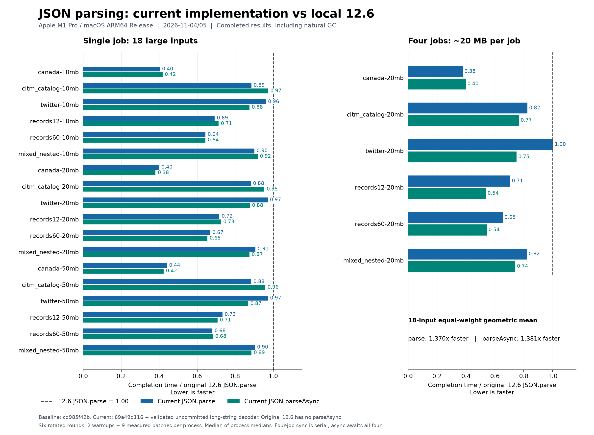

# JSON.parse / JSON.parseAsync 与本地 12.6 分支的性能对比

报告日期：2026-11-05。测量从 2026-11-04 23:43:12 至 2026-11-05 00:31:37（Asia/Taipei，UTC+8），文件名沿用实验启动日期。平台：Apple M1 Pro / 16 GiB / macOS 27.2（26B123）/ ARM64 Release。

本报告使用重新构建的原始 `12.6` 和当前优化实现，在同一测量轮次交替执行。当前实现包含尚未提交的长转义字符串解码优化；报告生成不修改解析器、不创建提交、不推送。

18 个大文件输入的等权几何平均结果：当前 `JSON.parse` 相对 `12.6 JSON.parse` 加速 **1.370×**，耗时降低 **26.99%**；当前 `JSON.parseAsync` 相对原版同步解析加速 **1.381×**，耗时降低 **27.61%**。这是所列输入的等权汇总，不是生产流量的加权收益。

专项仍有代价：本轮同步最大耗时增加为 **11.69%**（`escape_short`，1 个任务）；异步相对原版同步最大增加 **107.43%**（`short_wide`，1 个任务）。完整回退列表在下文，未用总体均值抵消或删除。

原始 `12.6` 没有 `JSON.parseAsync`，因此不存在原版异步接口对照。下文的异步对原版比较，含义是“异步完成时间与原版同步完成时间比较”。

[完整 JSON 证据](../tools/json_large/evidence/json-parse-vs-12.6-mac-arm64-20261104.json) · [可缩放图表](images/json-parse-vs-12.6-mac-arm64-20261104.svg)



## 比较对象和构建一致性

| 对象 | 源码 / 状态 |
| --- | --- |
| 原始 `12.6` | `cd985f42b1e54328dfa52a01149d9350701df5b8`，现有独立工作区干净，正常 Ninja 重建后无待构建任务。 |
| 当前实现 | `69a49d1160d91f7fb846b8cce80b5d0fb5c81b72` + `src/json/json-parser.cc` 的已验收长字符串解码补丁。完整补丁和源码哈希已冻结。 |
| `origin/12.6` | 本地远端跟踪引用为 `9d070a6d5194137ae2e2002076d915e015ebd4d6`，比本地分支多四个提交；本报告按用户指定的本地 `12.6` 比较，没有联网刷新或测量该跟踪引用。 |

两端使用相同 GN args：Release、`-O3`、无 LTO/PGO、系统 libc++、四个 V8 平台工作线程、4 GiB old-space 上限，i18n / Wasm / sandbox 关闭。编译器为 Apple Clang 21.0.0（clang-2100.4.1.1），SDK 与部署目标一致。实际 `json-parser.cc` 编译命令只有当前分支所需的 Highway 宏及 Dragonbox/Highway 头目录差异，其余编译选项一致。

旧基线的生成文件引用了已移除的 SDK，首次构建失败。该失败日志与旧二进制已保留；执行 GN 重新生成及完整 Ninja 构建后才开始计时。旧二进制与历史结果均未混入本次测量。

| 产物 | SHA-256 |
| --- | --- |
| 本轮 12.6 d8 | `edc49c58b1e3ae83e8d7518e973ae705a27f0cb8e37e367e8697c46f2b39c0b8` |
| 当前 d8 | `160088b32456e7118127ce424a11a5719ff4a3f8b2614ca8ff57aff8570ff8b5` |
| GN args | `9d3f09d82c98da7ffdc8e573f4ec9893e22288819e33e9d7217270e8c715131c` |
| 当前未提交源码补丁 | `477a0795615b913b2b83ce9069a92be76e33887b71ec896a4812c449c74fcf4e` |

比较范围是两个完整分支构建的累计差异，包含数字转换、字符串扫描、对象构建、异步调度/物化以及相关 GC 改进。不能将全部差异归因于最近的字符串补丁；最近一轮的独立对照见 [长字符串解码验收报告](json-parse-long-string-decoding.md)。

## 18 个大文件输入

单位为 ms。所有“降低”百分比为 `(基线耗时 - 当前耗时) / 基线耗时`，正值更快，负值更慢。加速倍数为基线耗时除以当前耗时。每行共用同一轮测得的原版基线。

| 输入 | 实际 UTF-8 MB | 12.6 parse | 当前 parse | 同步耗时降低 | 当前 parseAsync | 异步相对原版降低 | 异步 / 当前同步加速 |
| --- | ---: | ---: | ---: | ---: | ---: | ---: | ---: |
| canada-10mb | 10.451 | 51.084 | 20.604 | +59.67% | 21.333 | +58.24% | 0.966× |
| citm_catalog-10mb | 10.006 | 29.375 | 26.000 | +11.49% | 28.583 | +2.70% | 0.910× |
| twitter-10mb | 9.805 | 16.042 | 15.416 | +3.90% | 14.041 | +12.47% | 1.098× |
| records12-10mb | 10.000 | 26.625 | 18.416 | +30.83% | 18.980 | +28.72% | 0.970× |
| records60-10mb | 10.001 | 24.875 | 16.000 | +35.68% | 16.000 | +35.68% | 1.000× |
| mixed_nested-10mb | 10.000 | 34.562 | 31.125 | +9.95% | 31.729 | +8.20% | 0.981× |
| canada-20mb | 20.902 | 102.083 | 40.812 | +60.02% | 38.875 | +61.92% | 1.050× |
| citm_catalog-20mb | 20.012 | 58.959 | 52.000 | +11.80% | 56.229 | +4.63% | 0.925× |
| twitter-20mb | 20.077 | 35.125 | 34.104 | +2.91% | 30.792 | +12.34% | 1.108× |
| records12-20mb | 20.000 | 56.667 | 40.604 | +28.35% | 41.104 | +27.46% | 0.988× |
| records60-20mb | 20.001 | 50.917 | 34.022 | +33.18% | 33.271 | +34.66% | 1.023× |
| mixed_nested-20mb | 20.001 | 69.854 | 63.271 | +9.42% | 61.104 | +12.53% | 1.035× |
| canada-50mb | 50.166 | 244.688 | 107.771 | +55.96% | 103.646 | +57.64% | 1.040× |
| citm_catalog-50mb | 50.030 | 150.167 | 132.729 | +11.61% | 143.875 | +4.19% | 0.923× |
| twitter-50mb | 49.959 | 89.771 | 87.229 | +2.83% | 77.917 | +13.20% | 1.120× |
| records12-50mb | 50.000 | 149.688 | 109.667 | +26.74% | 105.875 | +29.27% | 1.036× |
| records60-50mb | 50.001 | 130.708 | 88.812 | +32.05% | 89.271 | +31.70% | 0.995× |
| mixed_nested-50mb | 50.000 | 172.792 | 156.083 | +9.67% | 153.042 | +11.43% | 1.020× |

Canada / CITM / Twitter 将固定公开种子的完整压缩文档重复放入顶层数组；后三族是确定性生成数据。MB 使用十进制，名称是目标大小，表内为实际 UTF-8 字节数；API 接收的是已读入的 JavaScript 字符串。完整输入哈希、种子提交和构造规则保留在本地证据目录。

| 汇总口径：18 个输入等权 | 几何平均加速 | 几何平均耗时降低 | 更快 / 更慢 / 持平输入数 |
| --- | ---: | ---: | ---: |
| 当前同步 / 原版同步 | 1.370× | +26.99% | 18 / 0 / 0 |
| 当前异步 / 原版同步 | 1.381× | +27.61% | 18 / 0 / 0 |
| 当前异步 / 当前同步 | 1.009× | +0.85% | 9 / 8 / 1 |

## 四任务吞吐与入口返回时间

每任务约 20 MB，总输入约 80 MB；同步执行四次串行 `JSON.parse`，异步连续提交四次并等待 `Promise.all` 完成。这里比较整批完成时间，不把总耗时除以四当作单任务延迟。固定四个 worker；异步顶层数组的内部并行也共享该线程池。

| 输入 | 原版四次同步 | 当前四次同步 | 当前四任务异步 | 同步相对原版降低 | 异步相对原版降低 | 异步 / 当前同步加速 |
| --- | ---: | ---: | ---: | ---: | ---: | ---: |
| canada-20mb | 468.688 | 177.063 | 186.750 | +62.22% | +60.15% | 0.948× |
| citm_catalog-20mb | 287.667 | 237.292 | 220.500 | +17.51% | +23.35% | 1.076× |
| twitter-20mb | 155.875 | 156.145 | 116.917 | -0.17% | +24.99% | 1.336× |
| records12-20mb | 281.104 | 198.313 | 151.167 | +29.45% | +46.22% | 1.312× |
| records60-20mb | 235.188 | 153.958 | 127.979 | +34.54% | +45.58% | 1.203× |
| mixed_nested-20mb | 320.333 | 263.042 | 237.250 | +17.89% | +25.94% | 1.109× |

六类四任务输入等权汇总：当前异步相对原版四次同步为 **1.649×**，耗时降低 **39.37%**；相对当前四次同步为 **1.156×**，耗时降低 **13.48%**。相对当前同步，5 类更快，1 类更慢。

异步入口返回时间仅包含调用及提交阶段；后续仍有 isolate 线程上的对象构建与 GC。因此下表不能解释为主线程总占用，更不能直接推导 UI 帧率。

| 20 MB 输入 | 单任务提交 / 全部完成 ms | 四任务提交 / 全部完成 ms |
| --- | ---: | ---: |
| canada-20mb | 0.625 / 38.875 | 9.250 / 186.750 |
| citm_catalog-20mb | 0.958 / 56.229 | 9.896 / 220.500 |
| twitter-20mb | 0.875 / 30.792 | 4.896 / 116.917 |
| records12-20mb | 0.625 / 41.104 | 5.375 / 151.167 |
| records60-20mb | 0.625 / 33.271 | 5.042 / 127.979 |
| mixed_nested-20mb | 1.000 / 61.104 | 9.187 / 237.250 |

## 数字与字符串专项

这些是独立构造的批量数组工作负载，输入大小和内容比例不同，旨在暴露数字分布、转义密度和字符宽度的差异。下列结果不应作为所有 JSON 的典型收益。`smi` 为小整数，`widen` / `narrow` 为一/双字节输入与结果宽度转换，`127/128/129` 覆盖长解码路径阈值。

| 输入 | MB | 原版 parse | 当前 parse | 同步降低 | 当前 parseAsync | 异步相对原版降低 |
| --- | ---: | ---: | ---: | ---: | ---: | ---: |
| alternating_numbers | 2.100 | 10.042 | 6.688 | +33.40% | 9.604 | +4.36% |
| alternating_pairs | 1.700 | 15.813 | 8.917 | +43.61% | 19.312 | -22.13% |
| dense_then_long | 5.155 | 3.542 | 3.562 | -0.58% | 3.417 | +3.53% |
| double_pairs | 2.400 | 22.271 | 9.646 | +56.69% | 21.562 | +3.18% |
| double_run | 4.950 | 13.417 | 3.416 | +74.54% | 3.146 | +76.55% |
| escape_boundary | 6.540 | 4.792 | 1.250 | +73.91% | 2.250 | +53.05% |
| escape_dense | 4.575 | 7.166 | 7.271 | -1.46% | 10.812 | -50.88% |
| escape_dense_4096 | 6.146 | 9.125 | 9.125 | +0.00% | 14.000 | -53.42% |
| escape_dense_long | 5.778 | 8.583 | 8.687 | -1.21% | 13.250 | -54.37% |
| escape_first_long | 5.145 | 3.542 | 2.042 | +42.35% | 1.834 | +48.24% |
| escape_length_127 | 5.240 | 4.146 | 4.333 | -4.51% | 4.834 | -16.59% |
| escape_length_128 | 5.280 | 3.917 | 3.334 | +14.88% | 3.833 | +2.13% |
| escape_length_129 | 5.320 | 4.020 | 3.208 | +20.21% | 3.833 | +4.66% |
| escape_length_63 | 2.680 | 2.292 | 2.458 | -7.24% | 3.105 | -35.45% |
| escape_length_64 | 2.720 | 2.458 | 2.584 | -5.11% | 3.229 | -31.37% |
| escape_narrow | 6.540 | 5.791 | 1.833 | +68.34% | 2.917 | +49.63% |
| escape_short | 5.400 | 5.708 | 6.375 | -11.69% | 7.416 | -29.93% |
| escape_wide_dense | 4.380 | 6.958 | 6.583 | +5.39% | 9.792 | -40.73% |
| escape_wide_dense_4096 | 6.453 | 9.812 | 9.125 | +7.01% | 13.041 | -32.91% |
| escape_wide_dense_long | 6.930 | 10.250 | 9.583 | +6.51% | 13.959 | -36.19% |
| escape_widen | 6.588 | 6.125 | 2.583 | +57.83% | 3.458 | +43.54% |
| integer12_run | 3.120 | 8.959 | 2.667 | +70.23% | 4.417 | +50.69% |
| long_ascii | 4.836 | 2.125 | 0.750 | +64.71% | 1.375 | +35.29% |
| short_ascii | 4.500 | 4.541 | 4.333 | +4.58% | 4.959 | -9.21% |
| short_latin1 | 4.500 | 4.459 | 4.229 | +5.15% | 4.917 | -10.28% |
| short_wide | 4.200 | 3.917 | 4.167 | -6.38% | 8.125 | -107.43% |
| smi_pairs | 1.400 | 8.667 | 7.958 | +8.17% | 13.709 | -58.17% |
| smi_run | 3.833 | 5.312 | 4.500 | +15.29% | 9.542 | -79.61% |
| sparse_repeated | 5.295 | 3.666 | 2.875 | +21.59% | 3.666 | +0.00% |
| sparse_then_dense | 5.900 | 7.167 | 6.020 | +16.00% | 9.417 | -31.39% |
| wide_escape_prefix | 5.400 | 6.666 | 7.000 | -5.01% | 6.938 | -4.07% |

这 31 个专项等权汇总：当前同步相对原版同步加速 1.393×（耗时降低 28.22%）；当前异步相对原版同步为 0.993×（耗时增加 0.73%）。它们与大文件矩阵分开汇总，不按任意混合权重生成单一总体收益。

| 字符串四任务输入 | 原版四次同步 | 当前四次同步 | 当前四任务异步 | 同步降低 | 异步相对原版降低 |
| --- | ---: | ---: | ---: | ---: | ---: |
| escape_boundary | 24.125 | 9.437 | 8.812 | +60.88% | +63.47% |
| escape_dense_long | 35.396 | 35.542 | 38.021 | -0.41% | -7.42% |
| escape_narrow | 27.605 | 11.584 | 9.375 | +58.04% | +66.04% |
| escape_widen | 27.396 | 12.042 | 12.145 | +56.04% | +55.67% |
| sparse_repeated | 16.542 | 13.354 | 10.750 | +19.27% | +35.01% |

## 回退和资源代价


当前同步相对原版同步：60 个测量场景中有 11 个耗时更高。

| 场景 | 任务数 | 耗时降低（负值为回退） | 配对比值中位数 |
| --- | ---: | ---: | ---: |
| escape_short | 1 | -11.69% | 1.1169 |
| escape_length_63 | 1 | -7.24% | 1.0724 |
| short_wide | 1 | -6.38% | 1.0532 |
| escape_length_64 | 1 | -5.11% | 1.0508 |
| wide_escape_prefix | 1 | -5.01% | 1.0501 |
| escape_length_127 | 1 | -4.51% | 1.0402 |
| escape_dense | 1 | -1.46% | 1.0117 |
| escape_dense_long | 1 | -1.21% | 1.0097 |
| dense_then_long | 1 | -0.58% | 1.0000 |
| escape_dense_long | 4 | -0.41% | 1.0041 |
| twitter-20mb | 4 | -0.17% | 1.0023 |

当前异步相对原版同步：60 个测量场景中有 19 个耗时更高。

| 场景 | 任务数 | 耗时降低（负值为回退） | 配对比值中位数 |
| --- | ---: | ---: | ---: |
| short_wide | 1 | -107.43% | 2.0691 |
| smi_run | 1 | -79.61% | 1.7998 |
| smi_pairs | 1 | -58.17% | 1.5817 |
| escape_dense_long | 1 | -54.37% | 1.5414 |
| escape_dense_4096 | 1 | -53.42% | 1.5285 |
| escape_dense | 1 | -50.88% | 1.5088 |
| escape_wide_dense | 1 | -40.73% | 1.4073 |
| escape_wide_dense_long | 1 | -36.19% | 1.3659 |
| escape_length_63 | 1 | -35.45% | 1.3546 |
| escape_wide_dense_4096 | 1 | -32.91% | 1.3291 |
| sparse_then_dense | 1 | -31.39% | 1.3139 |
| escape_length_64 | 1 | -31.37% | 1.3160 |
| escape_short | 1 | -29.93% | 1.2993 |
| alternating_pairs | 1 | -22.13% | 1.2226 |
| escape_length_127 | 1 | -16.59% | 1.1659 |
| short_latin1 | 1 | -10.28% | 1.1024 |
| short_ascii | 1 | -9.21% | 1.1011 |
| escape_dense_long | 4 | -7.42% | 1.0741 |
| wide_escape_prefix | 1 | -4.07% | 1.0438 |

以下为 50 MB 单任务整进程峰值 RSS 的六次运行中位数，单位 MiB。包含输入、预热、结果保留、校验及 GC；不能当作 API 单次分配量。整进程 CPU、RSS 最大值和所有过程范围见 JSON 证据。本次没有采集独立 worker / 前台 / GC 阶段 CPU，无法用这些资源数据进行阶段归因。

| 输入 | 原版 parse RSS | 当前 parse RSS | 当前 parseAsync RSS |
| --- | ---: | ---: | ---: |
| canada-50mb | 209.5 | 211.5 | 304.9 |
| citm_catalog-50mb | 237.3 | 237.9 | 407.8 |
| twitter-50mb | 196.9 | 196.9 | 308.2 |
| records12-50mb | 184.2 | 185.5 | 303.7 |
| records60-50mb | 159.9 | 160.3 | 286.6 |
| mixed_nested-50mb | 274.1 | 274.5 | 422.5 |

## 测量方法与正确性边界

- 60 个输入/任务数场景，三个执行方式，固定六轮；合格进程 **1,080** 个、计时批次 **9,720** 个，每进程另有两次预热。每次完整解析结果均通过树指纹校验，涵盖全部键、值、UTF-16 字符和数字位值。
- 三种方式按 `ABC / CBA / BCA / ACB / CAB / BAC` 轮换，每种方式在三个位置各出现两次。场景顺序以固定种子打乱。表中为六个进程中位数的中位数；JSON 同时保留六个配对比值、其比值中位数、54 个批次的 p90 及进程中位数范围。范围不是统计置信区间。
- 计时包含自然 GC、异步排队、前台物化与 Promise 完成；文件读取、字符串准备、轮前显式 GC 和结果校验在计时外。本任务的构建、正确性测试和制图均不与正式计时并行。
- 性能场景使用无 reviver 的普通调用及已经 flatten 的字符串，并经过两次预热；反映重复负载，不代表首次调用、流式 I/O 或 reviver 性能。reviver 的正确性验证见上一轮验收。
- 两端计时器本轮探测到的最小正步长均约 0.041 ms；专项用例中的小幅百分比变化需结合绝对差值和全部六轮范围解读，不声称统计显著性。
- 预先声明的编译干扰规则保留 **8** 组诊断记录（**144** 个进程），完整整组重测；总共记录 **1224** 个进程。只因进程边界观察到编译器才排除该组，不依据速度删样本或补测。其他系统活动保留在边界快照中；这不是独占机器或连续噪声监控。
- 另有 29 个合格进程的边界观察到 CPU 使用率至少 20% 的其他 `perf` 进程，详情见 JSON 的 `other_host_performance_processes`。它们按预先规定保留，未以结果为由追加排除规则；这是小幅差异解读的额外限制。
- 本轮新执行三套 JSONTestSuite：原版同步、当前同步、当前异步，各 293 条，输出逐条完全一致。原版没有异步接口。
- 当前实现此前完成的 Release / DCHECK 各 41 项验证，在本轮逐项确认验收源码和二进制哈希未变后复用，未声称重新执行。包括 7,444 次字符串解码校验、reviver/source、GC 压力与原生异步测试。
- 本轮只验证本机 macOS ARM64 Release；不外推 Android、ARM32、x64、其他 GC 配置或宿主 UI 响应。此前的 Android 编译检查不构成本次设备性能证据。

## 本地复现

本地完整目录为 `out/json-v12-6-compare-20261104/`，保存两端冻结 d8、GN 参数、当前源码补丁、源文件、构建/正确性日志、固定协议、输入 SHA-256、所有原始进程及每组处置记录。`main-corpus` / `micro-corpus` 为既有证据语料的符号链接，迁移目录时需要一并复制链接目标。

```sh
python3 out/json-v12-6-compare-20261104/measure.py replay
python3 out/json-v12-6-compare-20261104/summarize.py replay
```

请使用新标签，执行器拒绝覆盖已有原始记录；开始和结束时检查二进制、脚本、配置及全部输入哈希。正式数据标签为 `final`。旧分支报告未被改写，本报告是针对当前源码的新一轮直接比较。
