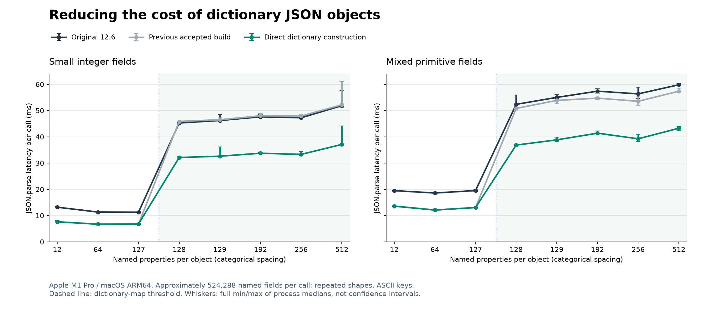

# ≥128 属性 JSON 对象：字典构建优化报告

日期：2026-10-29。平台：Apple M1 Pro / macOS ARM64。基线为上轮已验收的 blockscan，候选为 normalized；这是两个冻结二进制标签，源码仍位于未提交的工作树补丁中。

**目标已达到：128、129、192 个唯一命名属性的对象数组，在 Smi 与混合值两类输入中，同步解析耗时降低 24.37%–29.99%。** 六个目标的汇总中位数比例和配对变化中位数均超过预设的 20%。全部同步 3%、异步 5% 回退控制通过。

[完整结果 JSON](../tools/json_large/evidence/wide-dictionary-mac-arm64-20261029.json) · [上一轮报告与基线说明](json-parse-final-mac-arm64.md)

## 实现与适用范围

Factory::ObjectLiteralMapFromCache 在预计命名属性条目数达到 JSObject::kMapCacheSize（128）时返回字典 map。重复键可能使这个估算数高于最终唯一属性数。原 JSON 构建器随后逐个经过 LookupIterator、通用属性定义和字典写入流程。

本次保持字典表示和原有容量策略，在 JSON 专用的独立函数 BuildJsonDictionary 中创建对象，并调用既有 JSObject::SetNormalizedProperty 填入属性。解析器已验证这些条目是新普通对象的命名数据属性，键也已经内部化，因此无需再次执行通用属性定义流程。没有增加全局 map 缓存、对象形状缓存或每个解析任务的状态。

既有字典写入接口负责重复键覆盖时保留枚举位置、属性值和描述符写入、interesting-property 元数据及写屏障。数组索引仍由原逻辑构造 elements。快速 map 反馈继续使用原构建器；启用实验性字典属性常量跟踪的构建也保留原路径。JSON.parseAsync 的普通结束构建与 128 字段扁平对象构建可以复用该改动，工作预算、2 ms 软时限和检查位置未调整。

代码入口：[json-parser.cc](../src/json/json-parser.cc)。新增正确性用例：[parse-wide-dictionary.js](../test/json/parse-wide-dictionary.js) 和 [test-json-async.cc](../test/cctest/test-json-async.cc) 中的 JsonParseAsyncDictionaryObjectsSurviveGC。没有修改 Factory、Map、JSDataObjectBuilder 或 MessagePack 的通用构建逻辑。

这项优化减少字典构造成本，未消除 128 属性处的对象表示分界。最终对象仍使用字典存储，后续继续优化时应区分构造开销与字典表示自身的访问、内存成本。

## 同步核心目标及原始 12.6 对比

目标输入是同形状记录数组；每次调用约 524,288 个原始命名属性条目，记录数为 floor(524288 / width)。核心六项均为唯一 ASCII 键。混合值包含 Smi、小数、负零、字符串、布尔值、null 和大整数。输入由原始 JSON 文本生成，所有参与版本生成的全部文本字节先比较 SHA-256。

| 属性数 | 值类型 | 12.6 ms | 上轮基线 ms | 本次 ms | 对上轮降低 | 配对降低中位数 | 对 12.6 降低 |
|---:|---|---:|---:|---:|---:|---:|---:|
| 128 | mixed | 52.354 | 50.812 | 36.833 | 27.51% | 27.51% | 29.65% |
| 128 | smi | 45.250 | 45.854 | 32.104 | 29.99% | 29.91% | 29.05% |
| 129 | mixed | 55.000 | 53.854 | 38.833 | 27.89% | 27.63% | 29.39% |
| 129 | smi | 46.208 | 46.500 | 32.604 | 29.88% | 29.61% | 29.44% |
| 192 | mixed | 57.375 | 54.708 | 41.375 | 24.37% | 24.16% | 27.89% |
| 192 | smi | 47.584 | 48.000 | 33.729 | 29.73% | 29.61% | 29.12% |



[SVG 图](images/json-wide-dictionary-mac-arm64.svg) · [PNG 图](images/json-wide-dictionary-mac-arm64.png)

## 边界、UTF-16、冷键与形状变化

下表包含全部 36 项同步宽对象测试。same 是相同键序；reverse 交替反转键序；churn 使用 8 组键名并改变字段值类型；cold 的每个对象、每个预热/计时轮次使用不同键名；single 在一批中多次解析单个根对象；duplicates 的原始条目数为宽度、最终唯一命名键数为宽度的一半。indexed 另外含整数索引及名为 4294967295 的普通属性。

冷键输入在计时前生成，每个样本只解析一次，不重复使用该样本的键集合。单对象和较短负载按预先校准的固定次数组成批次，所有版本使用相同次数；表中是每个重复组的 ms，不应解读为逐个独立冷启动调用的延迟。

| 用例 | 上轮 ms | 本次 ms | 耗时降低 | 配对降低中位数 | 上轮 RSS MiB | 本次 RSS MiB |
|---|---:|---:|---:|---:|---:|---:|
| churn-128-mixed-ascii | 62.5625 | 49.1045 | 21.51% | 21.94% | 79.9 | 79.9 |
| churn-192-mixed-ascii | 63.8335 | 49.3540 | 22.68% | 22.01% | 88.0 | 88.2 |
| cold-128-mixed-ascii | 173.5415 | 161.3955 | 7.00% | 9.86% | 305.5 | 305.5 |
| cold-192-mixed-ascii | 208.4370 | 199.3750 | 4.35% | 11.36% | 306.0 | 305.2 |
| duplicates-128-mixed-ascii | 42.2915 | 32.2500 | 23.74% | 24.35% | 71.4 | 71.3 |
| duplicates-192-mixed-ascii | 46.4165 | 35.6455 | 23.21% | 22.96% | 78.8 | 78.7 |
| indexed-128-mixed-ascii | 52.3750 | 39.0000 | 25.54% | 25.68% | 78.4 | 78.2 |
| indexed-192-mixed-ascii | 52.0830 | 38.5210 | 26.04% | 26.25% | 85.4 | 85.7 |
| reverse-128-mixed-ascii | 50.2295 | 37.3535 | 25.63% | 25.63% | 76.2 | 76.2 |
| reverse-192-mixed-ascii | 56.0000 | 42.5830 | 23.96% | 23.75% | 84.5 | 84.4 |
| same-12-mixed-ascii | 13.6458 | 13.5730 | 0.53% | 0.61% | 63.3 | 63.6 |
| same-12-smi-ascii | 7.6042 | 7.6110 | -0.09% | -0.09% | 58.6 | 58.5 |
| same-127-mixed-ascii | 13.0417 | 13.0522 | -0.08% | 0.08% | 60.8 | 60.9 |
| same-127-mixed-utf16 | 17.2082 | 17.6770 | -2.72% | -0.79% | 80.4 | 80.4 |
| same-127-smi-ascii | 6.7917 | 6.8057 | -0.21% | -0.21% | 52.2 | 52.1 |
| same-127-smi-utf16 | 12.1667 | 12.2812 | -0.94% | -0.69% | 58.6 | 58.7 |
| same-128-mixed-ascii | 50.8125 | 36.8330 | 27.51% | 27.51% | 76.0 | 76.0 |
| same-128-mixed-utf16 | 54.0415 | 39.7290 | 26.48% | 26.27% | 87.5 | 87.5 |
| same-128-smi-ascii | 45.8540 | 32.1040 | 29.99% | 29.91% | 66.6 | 66.0 |
| same-128-smi-utf16 | 47.4375 | 33.2920 | 29.82% | 29.85% | 73.5 | 74.1 |
| same-129-mixed-ascii | 53.8540 | 38.8330 | 27.89% | 27.63% | 75.9 | 76.0 |
| same-129-smi-ascii | 46.5000 | 32.6040 | 29.88% | 29.61% | 66.3 | 66.0 |
| same-192-mixed-ascii | 54.7085 | 41.3750 | 24.37% | 24.16% | 84.3 | 84.1 |
| same-192-mixed-utf16 | 58.7290 | 44.6460 | 23.98% | 24.23% | 94.9 | 94.9 |
| same-192-smi-ascii | 48.0000 | 33.7290 | 29.73% | 29.61% | 77.9 | 77.9 |
| same-192-smi-utf16 | 51.4375 | 37.6040 | 26.89% | 27.08% | 85.3 | 85.4 |
| same-256-mixed-ascii | 53.5210 | 39.2295 | 26.70% | 26.39% | 76.1 | 76.2 |
| same-256-smi-ascii | 47.8960 | 33.2915 | 30.49% | 30.37% | 65.8 | 65.6 |
| same-512-mixed-ascii | 57.3540 | 43.2505 | 24.59% | 24.45% | 76.1 | 76.2 |
| same-512-mixed-utf16 | 67.3540 | 51.2710 | 23.88% | 23.33% | 87.6 | 87.6 |
| same-512-smi-ascii | 52.1880 | 37.0835 | 28.94% | 28.86% | 65.4 | 65.4 |
| same-512-smi-utf16 | 53.5005 | 38.1250 | 28.74% | 28.93% | 73.0 | 72.9 |
| same-64-mixed-ascii | 12.1247 | 12.0835 | 0.34% | 0.86% | 60.8 | 60.9 |
| same-64-smi-ascii | 6.7083 | 6.7152 | -0.10% | -0.10% | 52.3 | 52.3 |
| single-128-mixed-ascii | 0.0121 | 0.0087 | 28.06% | 27.39% | 44.0 | 43.9 |
| single-192-mixed-ascii | 0.0225 | 0.0176 | 22.03% | 21.97% | 69.5 | 69.1 |

RSS 是整个进程的峰值中位数，包含输入生成、所有冷键样本的文本、结果保留、校验与 GC，不能当作单次解析的分配量。CPU 与每个进程的峰值、全部时长也保存在完整数据中。

## 数字、字符串与大文件控制

| 微基准 | jobs | 上轮 ms | 本次 ms | 耗时降低 | 配对降低中位数 |
|---|---:|---:|---:|---:|---:|
| dense_unicode | 1 | 2.3102 | 2.3125 | -0.10% | -0.20% |
| dense_unicode | 4 | 9.5625 | 9.4097 | 1.60% | 2.09% |
| integers | 1 | 1.5240 | 1.5048 | 1.26% | -0.00% |
| integers | 4 | 6.3074 | 6.0053 | 4.79% | 4.28% |
| long_ascii | 1 | 0.4787 | 0.4773 | 0.30% | 0.00% |
| long_ascii | 4 | 1.9186 | 1.9243 | -0.30% | -0.29% |
| long_unicode | 1 | 0.3758 | 0.3773 | -0.42% | -0.31% |
| long_unicode | 4 | 1.5064 | 1.5048 | 0.11% | 0.22% |
| short_ascii | 1 | 1.8929 | 1.8829 | 0.52% | 0.16% |
| short_ascii | 4 | 7.0035 | 7.0521 | -0.69% | -1.45% |
| short_fractions | 1 | 1.7425 | 1.7443 | -0.11% | -0.21% |
| short_fractions | 4 | 6.9792 | 6.9792 | 0.00% | -0.10% |
| smi_records | 1 | 11.0625 | 10.9583 | 0.94% | 0.44% |
| smi_records | 4 | 41.6665 | 41.1250 | 1.30% | 1.05% |
| unique_doubles | 1 | 2.7976 | 2.8006 | -0.11% | -0.21% |
| unique_doubles | 4 | 11.2500 | 11.2188 | 0.28% | -0.18% |

jobs=4 在同步微基准中表示每组四次串行调用。沿用上一轮已校准的固定批次，完整核对每个结果的值、键序与原型，校验位于 API 计时之外。

| 大文件 | MB | 12.6 ms | 上轮 ms | 本次 ms | 对上轮降低 | 对 12.6 降低 |
|---|---:|---:|---:|---:|---:|---:|
| canada | 10 | 53.042 | 23.792 | 23.625 | 0.70% | 55.46% |
| canada | 50 | 263.979 | 129.167 | 126.458 | 2.10% | 52.10% |
| citm_catalog | 10 | 34.000 | 29.417 | 29.354 | 0.21% | 13.66% |
| citm_catalog | 50 | 164.625 | 142.729 | 145.729 | -2.10% | 11.48% |
| mixed_nested | 10 | 35.208 | 31.604 | 31.375 | 0.72% | 10.89% |
| mixed_nested | 50 | 189.645 | 171.958 | 174.104 | -1.25% | 8.20% |
| records12 | 10 | 27.250 | 18.959 | 18.729 | 1.21% | 31.27% |
| records12 | 50 | 159.083 | 118.396 | 119.791 | -1.18% | 24.70% |
| records60 | 10 | 25.188 | 16.334 | 16.166 | 1.03% | 35.82% |
| records60 | 50 | 141.104 | 95.834 | 96.729 | -0.93% | 31.45% |
| twitter | 10 | 16.562 | 16.291 | 16.500 | -1.28% | 0.38% |
| twitter | 50 | 96.959 | 95.687 | 95.792 | -0.11% | 1.20% |

大文件对照复用先前固定的输入与校验和：Canada、CITM、Twitter 由公开种子文档完整重复后包装为数组；records12、records60、mixed_nested 为确定性合成输入。构造细节见 [generate.py](../tools/json_large/generate.py) 和 [来源与版本](../tools/json_large/source-pins.json)。总体收益不外推为任意生产 JSON 的预期收益。

## 异步复核

原始 12.6 不提供 JSON.parseAsync，异步部分仅比较上轮已验收版本与本次候选。四任务是同一组同时提交四个 Promise，测量全部完成的墙钟时间，包含前台构建与自然 GC。

| 属性数 | 值类型 | jobs | 上轮 ms | 本次 ms | 耗时降低 | 配对降低中位数 |
|---:|---|---:|---:|---:|---:|---:|
| 64 | mixed | 1 | 18.750 | 18.709 | 0.22% | -0.80% |
| 64 | mixed | 4 | 52.104 | 49.166 | 5.64% | 7.27% |
| 64 | smi | 1 | 17.166 | 17.375 | -1.21% | -1.09% |
| 64 | smi | 4 | 37.729 | 37.583 | 0.39% | 0.83% |
| 127 | mixed | 1 | 20.958 | 20.688 | 1.29% | -0.12% |
| 127 | mixed | 4 | 52.645 | 53.751 | -2.10% | -2.46% |
| 127 | smi | 1 | 19.021 | 19.063 | -0.22% | -0.00% |
| 127 | smi | 4 | 42.625 | 43.062 | -1.03% | -1.27% |
| 128 | mixed | 1 | 53.229 | 40.375 | 24.15% | 24.03% |
| 128 | mixed | 4 | 178.396 | 123.312 | 30.88% | 31.39% |
| 128 | smi | 1 | 49.229 | 36.062 | 26.75% | 27.30% |
| 128 | smi | 4 | 171.604 | 116.917 | 31.87% | 31.59% |
| 129 | mixed | 1 | 63.042 | 48.646 | 22.84% | 22.53% |
| 129 | mixed | 4 | 228.376 | 174.208 | 23.72% | 23.71% |
| 129 | smi | 1 | 59.250 | 45.937 | 22.47% | 22.47% |
| 129 | smi | 4 | 208.542 | 154.562 | 25.88% | 26.26% |
| 192 | mixed | 1 | 63.480 | 49.896 | 21.40% | 21.29% |
| 192 | mixed | 4 | 238.833 | 182.896 | 23.42% | 23.08% |
| 192 | smi | 1 | 63.271 | 48.916 | 22.69% | 23.21% |
| 192 | smi | 4 | 212.834 | 153.000 | 28.11% | 28.20% |
| 512 | mixed | 1 | 70.250 | 53.688 | 23.58% | 23.76% |
| 512 | mixed | 4 | 259.584 | 191.854 | 26.09% | 26.25% |
| 512 | smi | 1 | 63.063 | 48.625 | 22.89% | 22.95% |
| 512 | smi | 4 | 227.396 | 167.312 | 26.42% | 26.43% |

| 50 MB 大文件 | jobs | 上轮 ms | 本次 ms | 耗时降低 | 配对降低中位数 |
|---|---:|---:|---:|---:|---:|
| canada | 1 | 279.146 | 278.812 | 0.12% | 0.06% |
| canada | 4 | 569.250 | 545.688 | 4.14% | 4.44% |
| citm_catalog | 1 | 220.458 | 216.750 | 1.68% | 4.25% |
| citm_catalog | 4 | 643.750 | 605.250 | 5.98% | -1.74% |
| mixed_nested | 1 | 231.771 | 231.229 | 0.23% | 0.55% |
| mixed_nested | 4 | 685.271 | 648.729 | 5.33% | 3.55% |
| records12 | 1 | 164.479 | 165.479 | -0.61% | -0.38% |
| records12 | 4 | 436.854 | 445.771 | -2.04% | -0.73% |
| records60 | 1 | 157.937 | 156.624 | 0.83% | 1.05% |
| records60 | 4 | 356.625 | 359.750 | -0.88% | -0.60% |
| twitter | 1 | 112.667 | 109.583 | 2.74% | 2.50% |
| twitter | 4 | 313.646 | 309.584 | 1.30% | 2.83% |

## 正确性、首次失败与保留的数据

- 40 项 Release + 40 项 DCHECK/verify-heap 命令全部通过，保留原数字、字符串、对象构建、clone、并发和生命周期检查。
- 新宽对象测试 163 个对照，与冻结基线的输出 hash b509d842 一致。覆盖 127/128/129/192/252/253/256/512/1024 属性、4096 属性单对象、ASCII/UTF-16/转义/重复/索引/特殊键、枚举与重插入顺序、属性描述符、数值独立性、reviver source 和精确错误消息。
- 新原生 GC 测试构建 700 个 128/192 属性对象，在保证仍 pending 的前两个切片后分别强制 GC，并检查全部字段与独立 double 值。默认、压缩、增量标记、minor-ms 在 Release/DCHECK 均通过。
- 18 份原大文件完整规范输出 SHA-256、全树指纹与基线一致；同步/异步合计 586 项 JSONTestSuite 检查通过。

- micro / long_unicode / parse / 1：首轮汇总 -4.926%、配对 -1.026%；按预案整套/整输入族补测后，合并 8 轮为 -0.416% / -0.312%。原样本全部保留并参与最终判定。

最初的单次 128 字段诊断为 48.5→35.125 ms，仅用于选择实现方向。正式数据不包含该诊断、校准或先行筛选。校准/先行运行器的汇总 repeats 字段曾误显示最后一个场景的次数，原始行和执行命令一直使用正确次数；正式运行前修正这一汇总字段，原运行器仍保留，未更改基准程序或样本。

## 方法、源码与复测

正式数据共 **1,408 个独立计时进程、12,672 个计时批次**。每进程预热 2 次、计时 9 次。宽对象和大文件同步比较包含 before/v12_6/normalized 三个版本，使用全部六种排列，每个版本在每个位置出现两次，每对版本的先后顺序均衡；其余两版本比较采用 AB/BA/BA/AB。固定种子打乱场景块，正式计时期间未并行运行本任务的构建、测试或其他性能任务。

验收同时使用进程中位数的中位数之比、以及配对变化中位数。任何控制首次越线，只允许按预案对整套场景或整个输入族追加一次完整轮次，并合并全部数据；目标未达到不靠选择性重跑补救。图中误差线为各进程中位数的最小/最大范围，不是置信区间。

配置沿用上轮：Apple M1 Pro、macOS 27.0.1，Apple Clang 21 / SDK 27，ARM64 Release -O3，无 LTO/PGO，系统 libc++，i18n/Wasm/sandbox 关闭。运行参数为 --expose-gc --thread-pool-size=4 --max-old-space-size=4096。本机 TimeTicks 有约 41.667 μs 量化，短负载先校准固定批长；没有修改生产计时器。

| 标签 | d8 SHA-256 | 字节数 |
|---|---|---:|
| v12_6 | `8131011b31ddb6e50e5ff1dde01e6ab2163b05461a615cccbbc2984feb92a484` | 17,206,512 |
| before | `e7c6973091f170d5e3585db1665bbe6e4bd719954175d98524a4f27e5f5e939a` | 17,836,592 |
| normalized | `507938bf75442aefb37a9bc1cb833ed7b200de72dd84e52eec77cf0868e76bf1` | 17,836,592 |
| normalized-dcheck | `2497d6677b05cd0e2187902ea28c675563187a4894af5ecf698f0b39ea0e2163` | 45,874,432 |

DCHECK 仅用于正确性检查，不混入 Release 性能数据。本次结果适用于所测 Mac ARM64 配置，不声称其他架构或实验性字典配置具有相同收益。

原始证据目录：`/Users/james/.codex/worktrees/json-async-wide-keys/v8-standalone/out/json-wide-dictionary-20261029`。plan.json 是正式测量前冻结的目标、场景和补测规则；manifests/ 和 sources/ 绑定二进制与源码；results/*-raw.jsonl 保留每次计时、执行命令与完整验证标识；before-working-tree.json 和 sources/before-working-tree/ 保留本轮开始时的已有改动。

在保留的证据目录中以新 tag 复测：

```sh
python3 out/json-wide-dictionary-20261029/run-wide.py sync --tag replay-wide-sync
python3 out/json-wide-dictionary-20261029/run-wide.py async --tag replay-wide-async
python3 out/json-wide-dictionary-20261029/run-micro.py --tag replay-micro
```

最终审计通过：Release/DCHECK 各 36 份源码与冻结快照一致，d8/cctest 及未剥离二进制哈希一致，Ninja 无待构建任务；所有正式数据计数、基准源码及 18 份输入文件 SHA-256 一致。Factory、Map 和通用 JSDataObjectBuilder 未改动；除本次明确修改的三个既有文件外，其余 33 个原有改动文件内容均保留。

审计结果：`out/json-wide-dictionary-20261029/results/final-audit.json`。只包含本轮增量代码、测试及说明的补丁：`out/json-wide-dictionary-20261029/results/delta-from-blockscan.patch`。实际内在函数检查也确认 127 属性仍为 fast properties，128/129/192/256/512 属性仍为 dictionary properties。

当前分支 codex/json-async-wide-keys。上轮的未提交工作已保留；本轮未自动提交、合并或推送。
